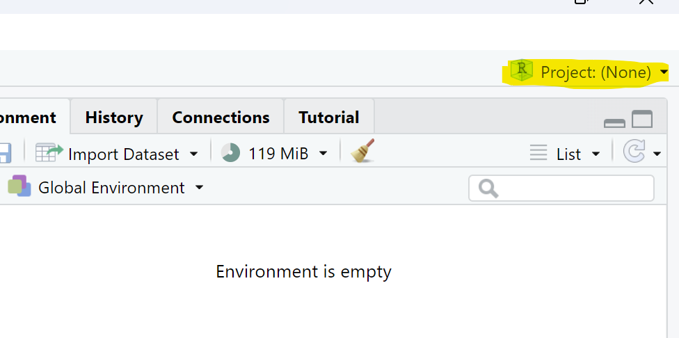
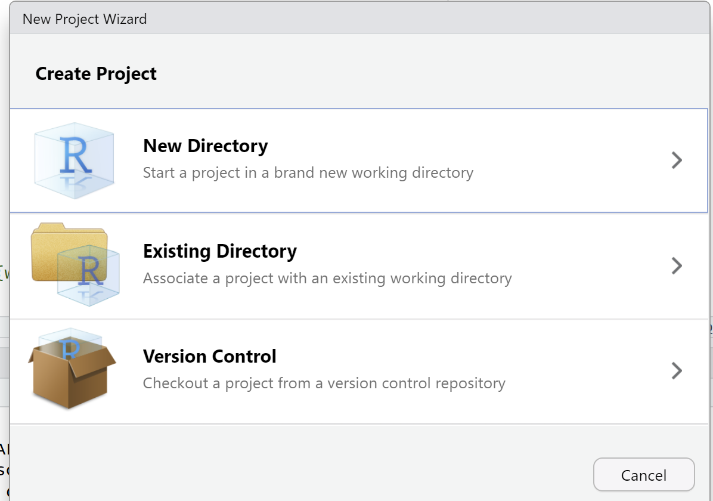
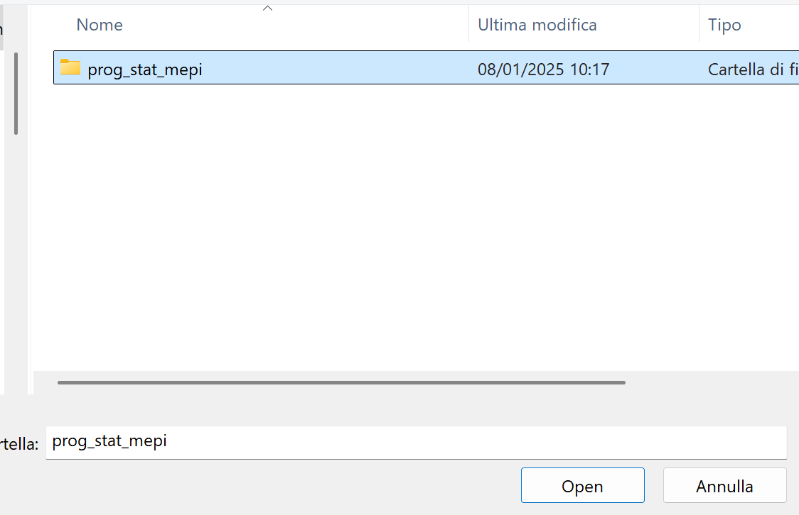
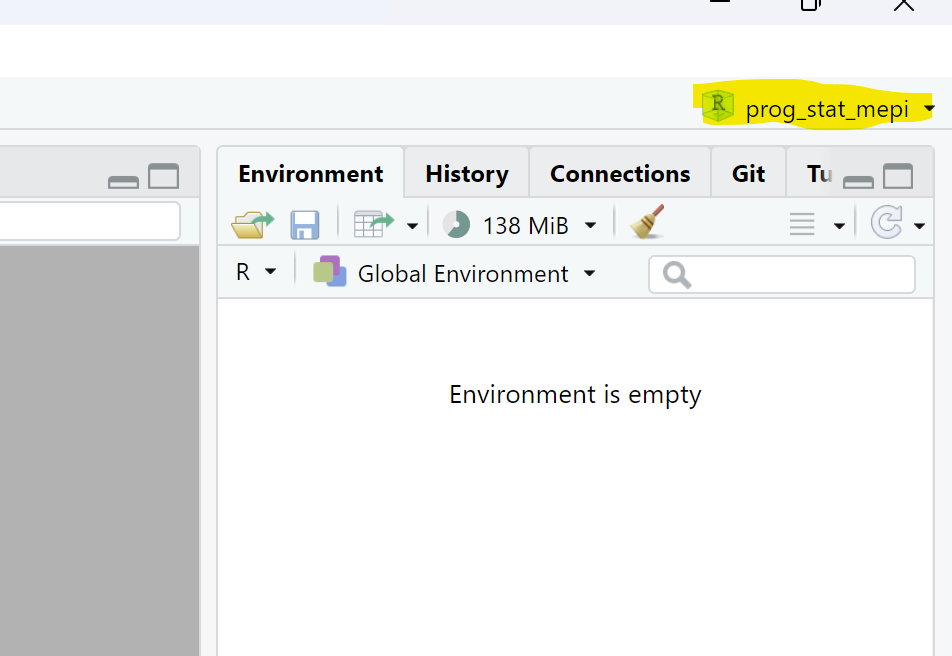
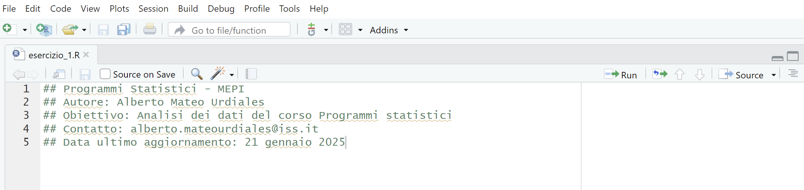
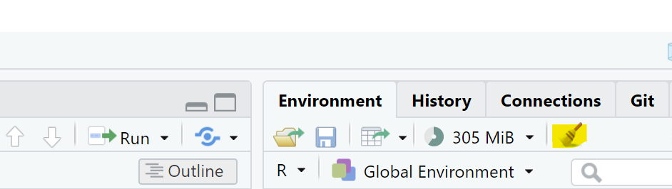

# **Master II livello Epidemiologia - Programmi Statistici**

# Sessione 1: Introduzione a R e RStudio - Importazione ed esplorazione di database {.unnumbered}

## Obiettivi di questa sesione

-   acquisire familiarità con l'interfaccia di RStudio,
-   capire l'importanza dei progetti in RStudio,
-   essere in grado di istallare e caricare pacchetti
-   essere in grado di eseguire calcoli semplici
-   essere in grado di utilizzare funzioni
-   essere in grado di leggere ed esplorare un database

### **Interfaccia di RStudio**

Come abbiamo detto durante la lezione, RStudio è un'interfaccia per
rendere più semplice l'uso di R. RStudio ha quattro riquadri (se vedi
soltanto 3 è sicuramente perché non hai aperto uno script).

Riquadro **source**: In alto a sinistra, è uno spazio per modificare,
eseguire e salvare gli script. Gli script contengono i comandi che vuoi
eseguire. Per gli utenti di Stata, questo riquadro è simile alle
finestre Do-file e Data Editor.

Riquadro **console**: Il riquadro inferiore sinistro è dove troviamo il
"motore" di RStudio: R. È qui che i comandi vengono effettivamente
eseguiti e vengono visualizzati output non grafici e messaggi di
errore/avvisi. Puoi scrivere ed eseguire direttamente i comandi nella
console, ma tieni presente che questi comandi non vengono salvati come
quando si eseguono i comandi da uno script.

Riquadro **environment**: In alto a destra, è utilizzato per
visualizzare gli oggetti (come per esempio database) importati o creati
nella sessione corrente.

Riquadro **plots, viewer, packages, and help**: Il riquadro in basso a
destra. La scheda "plots" mostrerà i grafici, mentre altri output
interattivi -come tabelle HTML- verranno visualizzati nella scheda
"viewer". La scheda pacchetti mostra i pacchetti installati e caricati,
permettendo anche l'installazione di nuovi pacchetti. Infine, la scheda
"help" si utilizza per ottenere informazioni su funzioni o pacchetti in
R.

Se vuoi sapere di più, leggi la sezione dell'EpiRhandbook [R
Studio](https://epirhandbook.com/en/new_pages/basics.html#rstudio)

### **Step 1: Creare un progetto**

Lavorare dentro un progetto di RStudio è importante perché:

-   rende più semplice l'importazione di database, così come
    l'esportazione o il salvataggio di outputs
-   permette di organizzare il lavoro in modo efficiente
-   permettere di condivere in modo efficiente il lavoro con altre
    persone: basta comprimere un progetto e inviarlo via email. Quelli
    che lo ricevono possono aprirlo e replicare esattamente il tuo
    lavoro!
-   può essere collegato a un software di version control come
    Git/Github

**Compito:**

-   Assicurati che la cartella *prog_stat_mepi* sia scaricata è
    **decompressa** nel tuo laptop
-   Apri RStudio
-   Crea un progetto di RStudio dentro la cartella *prog_stat_mepi*

<details>

<summary style="text-decoration: underline; color: darkgreen;">

`r fontawesome::fa("lightbulb", fill = "gold")` Clicca per leggere un
suggerimento

</summary>

</br>

Se non riesci, segui i passi indicati in questa sezione
dell'EpiRhandbook su [R
Projects](https://epirhandbook.com/en/new_pages/r_projects.html)

</br>

</details>

<details>

<summary style="text-decoration: underline; color: red;">

`r fontawesome::fa("check", fill = "red")`Clicca per vedere la soluzione
(provaci da solo prima!)

</summary>

</br>

Per creare un progetto, puoi cliccare su *File -\> New Project*. Puoi
anche farlo cliccando sul simbolo di R nell'angolo superiore a destra
(vedi immagine sotto) e poi scegliendo *New Project*.



Vedrai tre opzioni:

-   New Directory
-   Existing Directory
-   Version control



*New Directory* serve per **creare** una nuova cartella dove sarà creato
il progetto. Noi *non* vogliamo questa opzione perché abbiamo già una
cartella pronta.

*Existing Directory* serve per inserire il progetto in una cartella
esistente dentro il tuo laptop. **Scegli questa opzione** e seleziona
*browse*. Poi cerca la cartella \*\*prog_stat_mepi\* e clicca su *Open*
come indicato nell'immagine sotto



Dovresti vedere che RStudio si chiude e si riapre. Se tutto è andato a
buon fine, nell'angolo superiore a destra dovresti vedere adesso il nome
del progetto (come nell'immagine sotto).



</br>

</details>

:::: {.callout-note appearance="minimal" icon="false"}
**Rispond**

::: webex-check
```{r, results="asis", echo=FALSE}
pacman::p_load(webexercises)

opts <- c(
  "Un elenco di tutti i pacchetti di R",
  answer = "Vedo un file che sembra il progetto che ho creato e anche le sottocartelle data, scripts e outputs",
  "Non si vede niente",
  "Un elenco delle funzioni di R"
)


cat("Domanda: Una volta creato il progetto, cosa vedi nel riquadro 'Files' in basso a destra?", longmcq(opts))

```
:::
::::

### **Step 2: Creare uno script**

Come abbiamo detto durante la lezione, il nostro codice di R lo
scriviremo in uno script. Questo script -simile a un do-file per gli
utenti di STATA- è un documento che possiamo salvare e riprendere quando
vogliamo.

Ci sono due elementi dentro dello script: **codice e commenti**.
Commenti è qualsiasi cosa che scriviamo a destra di un simbolo
cancelletto (#). I commenti aiuto a te stesso e ad altri a capire cosa
fai e perché lo fai. Vedi lo esempio sotto:

```{r eval=FALSE, echo=TRUE}
# Questo è un commento
# Leggere i dati
casi <- import("linelist_raw.xlsx") %>%   # i commenti si possono anche inserire dopo codice
# filter(age > 50)                          # si possono anche usare per disattivare pezzi di codice
  count()

```

**Compito:**

-   Crea un nuovo script è salvalo nella sottocartella *scripts* col
    nome: *esercizio_1*
-   Nello script, comincia scrivendo dei commenti dove indichi: Nome e
    cognome; obiettivo dello script; tuo email e la data.

<details>

<summary style="text-decoration: underline; color: darkgreen;">

`r fontawesome::fa("lightbulb", fill = "gold")` Clicca per leggere un
suggerimento

</summary>

</br>

Per aprire uno script, seleziona *File -\> New File -\> R Script*.

</br>

</details>

<details>

<summary style="text-decoration: underline; color: red;">

`r fontawesome::fa("check", fill = "red")`Clicca per vedere la soluzione
(provaci da solo prima!)

</summary>

</br>

Il tuo script dovrebbe assomigliare a questo:



</br>

</details>

### **Step 3: Funzioni semplici**

Ricorda che c'è una differenza fondamentale tra chiedere a R di **fare
qualcosa e di stamparlo nella console** e chiedere a R di **fare
qualcosa e salvarlo nell'Environment**. Se noi scriviamo una funzione e
non usiamo **l'operatore di assegnazione** `->` R lo farà e lo stamperà
nella console. Se invece lo usiamo, lo salverà nell'Environment e nella
console vedremo soltanto il pezzo di codice che abbiamo lanciato, **ma
non l'output**.

**Compiti:**

-   Crea un vettore con i numeri: 24, 98, 233, 9823, 3, -76 e salvalo
    nell'Environment col nome *numeri*. Scrivi funzioni per calcolare:
    media, numero più alto, numero più baso e somma.
-   Salva la media in un oggetto chiamato *media_numeri*
-   Crea un vettore con le parole: Roma, Torino, Napoli, Milano, Bari
-   Crea una funzione che transformi questi nomi in lettere maiuscole e
    salva il vettore nell'Environment col nome citta_italiane

<details>

<summary style="text-decoration: underline; color: darkgreen;">

`r fontawesome::fa("lightbulb", fill = "gold")` Clicca per leggere un
suggerimento

</summary>

</br>

Per creare un vettore devi inserire i numeri (o le città) dentro della
funzione "concatenate" o `c()` separati da virgole. Ricorda che le
parole in R devo essere inserite tra virgolette, mentre i numeri no.

Se vuoi salvare il vettore nell'Environment, scrive il nome del vettore,
poi l'operatore di assegnazione `->` e poi il vettore.

Per calcolare la media puoi usare la funzione `mean()`, mentre per
rilevare il numero più alto `max()` e il numero più basso `min()`.
Invece, per trasformare un vettore testuale in lettere maiuscole puoi
usare la funzione `toupper()`.

</br>

</details>

<details>

<summary style="text-decoration: underline; color: red;">

`r fontawesome::fa("check", fill = "red")`Clicca per vedere la soluzione
(provaci da solo prima!)

</summary>

</br>

```{r , echo=TRUE}
numeri <- c(24, 98, 233, 9823, 3, -76)
max(numeri)
min(numeri)
media_numeri <- mean(numeri)


citta_italiane <- c("Roma", "Torino", "Napoli", "Milano", "Bari")
citta_italiane <- toupper(citta_italiane)

```

</br>

</details>

:::: {.callout-note appearance="minimal" icon="false"}
**Rispond**

::: webex-check
```{r, results="asis", echo=FALSE}
pacman::p_load(webexercises)

opts <- c(
  "4231.1",
  "12.98",
  answer = "1684.167",
  "9874.32"
)


cat("Domanda: Qual è la media del vettore 'numeri'?", longmcq(opts))

```
:::
::::

### **Step 4: Leggere ed esplorare dati di un focolaio di Ebola**

Adesso comincieremo ad analizzare dati più complessi che somigliano ai
dati che un epidemiologo trova nella vita reale.

Il database che useremo lo potete trovare nella sottocartella
"prog_stat_mepi/data" e si chiama *linelist_raw.xlsx*. Questo database
contiene dati fittizi che imitano dati individuali raccolti durante
un'epidemia di ebola. Il database è stato creato da AppliedEpi e si può
scaricare nel sito di [EpiRhandbook](https://epirhandbook.com/en/)

Puoi aprire il database in excel e dare uno sguardo se vuoi. Il file
*data_dictionary_linelist.xlsx* dentro la sottocartella
"prog_stat_mepi/data/data dictionaries" descrive il significato di ogni
variabile.

Nei prossimi passi eseguiremo le azioni necessarie per leggere ed
esploreare questo database.

#### 4.1. Creare un nuovo script

Utilizzeremo un nuovo script per questa analisi, quindi salva e chiudi
lo script *esercizio_1.R* e crea un nuovo script chiamato
*analisi_ebola*. Salvalo sempre nella sottocartella "scripts".
Assicurati che rimani sempre dentro del progetto *prog_stat_mepi*.
Assicurati anche che l'environment è pulito. Per pulirlo puoi cliccare
sul simbolo che somiglia una scopa in alto a destra (vedi immagine
sotto).



#### 4.2. Istallare e caricare i pacchetti necessari

Come abbiamo detto durante la lezione, la prima parte del nostro script
(oltre a includere -commentato- alcune informazioni sull'obiettivo,
autore, data dell'ultimo aggiornamento e dettagli di contatto) è
installare e caricare pacchetti.

Fortunatamente c'è un pacchetto che svolge questo compito in modo molto
efficace: {pacman}. La funzione `p_load()` di questo pacchetto
installerà tutti i pacchetti elencati non ancora installati e li
caricherà. Se un pacchetto elencato era già stato installato, lo
caricherà e basta. Puoi trovare maggiori informazioni
sull'installazione/caricamento di pacchetti nella sezione
[Packages](https://epirhandbook.com/en/new_pages/basics.html#packages)
dell'EpiRhandbook.

**Compito**:

-   Utilizzando l'approccio di `pacman::p_load()`, prova a installare e
    caricare i seguenti pacchetti: rio, janitor, lubridate, skimr,
    epikit, gtsummary e tidyverse.

<details>

<summary style="text-decoration: underline; color: darkgreen;">

`r fontawesome::fa("lightbulb", fill = "gold")` Clicca per leggere un
suggerimento

</summary>

</br>

Quando farai analisi più complesse, potresti finire per usare un lungo
elenco di pacchetti. Sfortunatamente, pacchetti diversi hanno funzioni
con lo stesso nome. Ad esempio, il pacchetto {dplyr} (già installato con
{tidyverse}) ha una funzione chiamata `select()` che usiamo
frequentemente per mantere un elenco di colonne di un database. Ma anche
altri pacchetti come {MASS} hanno una funzione chiamata `select()`.
Questo potrebbe creare problemi se vuoi mantere colonne usando
`select()` di dplyr ma R pensa che tu stia chiamando `select()` di MASS
(lo chiamiamo mascheramento: `select()` di dplyr è mascherato da
`select()` di MASS). Dato che è più probabile che tu usi funzioni da
{tidyverse}, assicurati che questo sia l'ultimo pacchetto nel tuo elenco
`p_load()` in modo che le funzioni da {tidyverse} (incluse le funzioni
{dplyr}) "prevalgano" sempre.

</br>

</details>

<details>

<summary style="text-decoration: underline; color: red;">

`r fontawesome::fa("check", fill = "red")`Clicca per vedere la soluzione
(provaci da solo prima!)

</summary>

</br>

```{r , echo=TRUE}
# installa (se necessario) da CRAN e carica i pacchetti da utilizzare
pacman::p_load(
  rio, # importazione dati
  skimr, # ottieni panoramica dei dati
  janitor, # pulizia dati e tabelle
  lubridate, # lavorare con le date
  epikit, # per creare categorie di età
  gtsummary, # statistiche riassuntive, test e regressioni
  tidyverse # gestione e visualizzazione dati
)
```

</br>

</details>

```{r , echo=FALSE, include=FALSE}
casi_ebola_grezzo <- import("../sessioni/prog_stat_mepi/data/linelist_raw.xlsx")
```

#### 4.3. Leggere i dati

Esistono diversi modi in cui puoi importare i diversi data frame. Il
file che noi vogliamo leggere (linelist_raw.xlsx) è un file excel. Un
modo di leggerlo potrebbe essere quello di usare una funzione R
specifica per importare file excel. Ad esempio, `read_excel()` da
{readxl}. Questo, però, significherebbe che dobbiamo usare una funzione
diversa per ogni tipo di file. Coiè, se vogliamo leggere un file .csv
dovremmo usare la funzione `read.csv()` da {base} o la funzione
`fromJSON()` da {jsonlite} per importare un file .json. Fortunatamente,
esiste un approccio più efficiente che consiste nell'usare la funzione
`import()` da {rio} per aprire **qualsiasi** file. Questa funzione
riconoscerà il tipo di file e sceglierà la funzione appropriata per
importarlo. Se vuoi saperne di più sulle funzioni di importazione, leggi
il capitolo [Import and Export](https://epirhandbook.com/en/new_pages/importing.html#import-data)
di EpiRhandbook.

**Compito**:

-   Importa il database *linelist_raw.xlsx* utilizzando `import()` da
    {rio} e salvalo nell'Environment col nome *casi_ebola_grezzo*.

<details>

<summary style="text-decoration: underline; color: red;">

`r fontawesome::fa("check", fill = "red")`Clicca per vedere la soluzione
(provaci da solo prima!)

</summary>

</br>

```{r , echo=TRUE, eval=FALSE}
# leggere i dati di Ebola
casi_ebola_grezzo <- import("data/linelist_raw.xlsx")

```

</br>

</details>

#### 4.4. Esplorare il database

**Compiti**:

Usando le funzioni che abbiamo visto durante la lezione per esplorare
database, prova a scoprire:

-   Il numero di colonne e righe

-   La classe delle colonne e se questa corrisponde alla sua natura (ad
    esempio, le "date" sono considerate "date" da R?)

-   Guarda le diverse categorie delle colonne su gender, hospital,
    outcome o fever. Pensi di aver bisogno di ricodificarne qualcuna?

-   Esplora la colonna "age". Pensi si deva cambiare qualcosa?

Prova a rispondere alle domande sotto!

<details>

<summary style="text-decoration: underline; color: darkgreen;">

`r fontawesome::fa("lightbulb", fill = "gold")` Clicca per leggere un
suggerimento

</summary>

</br>

Un modo efficiente per esplorare i dati è usare la funzione `skim()` dal
pacchetto {skimr}, poiché fornisce tutte le informazioni necessarie con
un solo comando. Naturalmente, ci sono diverse alternative. Per
conoscere le diverse categorie in una colonna, puoi usare la funzione
`tabyl()` da {janitor}, che ti fornirà conteggi e percentuali di ogni
categoria nella colonna di dati.

</br>

</details>

<details>

<summary style="text-decoration: underline; color: red;">

`r fontawesome::fa("check", fill = "red")`Clicca per vedere la soluzione
(provaci da solo prima!)

</summary>

</br>

```{r , echo=TRUE}
# esplorare tutto il database con skimr
skim(casi_ebola_grezzo)

# esplorare categorie di una variabile "character" o "factor"
tabyl(casi_ebola_grezzo, gender)
tabyl(casi_ebola_grezzo, hospital)
tabyl(casi_ebola_grezzo, fever)
```

</br>

</details>

::::::::: {.callout-note appearance="minimal" icon="false"}
**Rispondi!**

::: webex-check
```{r, results="asis", echo=FALSE}
pacman::p_load(webexercises)

opts <- c(
  answer = "28",
  "6611",
  "82",
  "4"
)


cat("Domanda: Quante colonne ci sono nel database?", longmcq(opts))

```
:::

::: webex-check
```{r, results="asis", echo=FALSE}
pacman::p_load(webexercises)

opts <- c(
  "6",
  answer = "7",
  "137",
  "876"
)


cat("Domanda: Quante osservazioni mancano nella colonna 'age_unit?", longmcq(opts))

```
:::

::: webex-check
```{r, results="asis", echo=FALSE}
pacman::p_load(webexercises)

opts <- c(
  "28",
   answer =  "8",
  "17",
  "3"
)


cat("Domanda: Quante variabili numeriche ci sono nel database?", longmcq(opts))

```
:::

::: webex-check
```{r, results="asis", echo=FALSE}
pacman::p_load(webexercises)

opts <- c(
  "52.7",
   "0.9",
  "48",
  answer = "54"
)


cat("Domanda: Qual è la mediana della variabile 'wt_kg'?", longmcq(opts))

```
:::

::: webex-check
```{r, results="asis", echo=FALSE}
pacman::p_load(webexercises)

opts <- c(
  "59.35",
  "0.04",
  answer =  "47.6",
  "52.9"
)


cat("Domanda: Qual è la percentuale di maschi (m)?", longmcq(opts))

```
:::

::: webex-check
```{r, results="asis", echo=FALSE}
pacman::p_load(webexercises)

opts <- c(
  "2015-10-19",
  "2022-01-31",
  answer =  "2012-05-14",
  "2014-09-13"
)


cat("Domanda: Qual è la prima data di ospedalizzazione", longmcq(opts))

```
:::
:::::::::

## Informazioni sull'esercizio

**Autore**

Autore originale: Alberto Mateo Urdiales (Dipartimento Malattie
Infettive, Istituto Superiore di Sanità\
Fonte dati: I dati sul focolaio di Ebola provengono da AppliedEpi e si
possono scaricare nel sito [EpiRhandbook](https://epirhandbook.com/en/);
i dati sul focolaio gastrointestinale fa parte dal pacchetto {EpiStats};
quello sul peso alla nascita dal pacchetto {MASS}\

| Date         | Changes made | Version | Author                 |
|--------------|:-------------|--------:|------------------------|
| Gennaio 2025 | First draft  |       1 | Alberto Mateo Urdiales |
