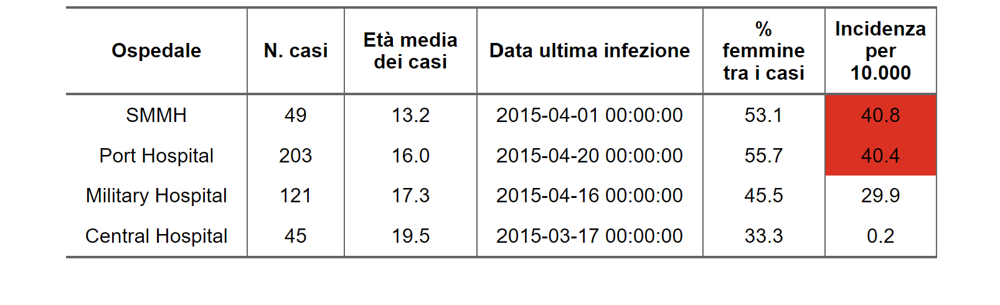

# **Master II livello Epidemiologia - Programmi Statistici**

# Sessione 3 - Raggruppare, linkare dati e creare tabelle:  {.unnumbered}

## Obiettivi di questa sesione

- imparare a raggruppare dati e creare tabelle in R,
- essere in grado di collegare diversi database
- acquisire conoscenze su come formattare una tabella ed esportarla


```{r , echo=FALSE, include=FALSE}
pacman::p_load(
  rio, # importazione dati
  skimr, # ottieni panoramica dei dati
  janitor, # pulizia dati e tabelle
  lubridate, # lavorare con le date
  epikit, # per creare categorie di età
  gtsummary, # statistiche riassuntive, test e regressioni
  tidyverse # gestione e visualizzazione dati
)

casi_ebola_pul <- import("../sessioni/prog_stat_mepi/data/casi_ebola_pul.csv")

osp_info <- import("../sessioni/prog_stat_mepi/data/hosp_info.RDS")

osp_info_pul <- osp_info %>% 
  mutate(hosp_name = recode(hosp_name,
                            "St. Mark's Maternity Hospital (SMMH)" = "SMMH")) %>% 
  filter(!(hosp_name == "Military Hospital" & level == "Primary"))

```

### **Preparazione**

In questo esercizio continueremo a lavorare sullo script *analisi_ebola.R* che abbiamo sviluppato nelle ultime due lezioni. 

Prima di cominciare, assicurati di:

1.    Avere RStudio aperto con il **progetto *prog_stat_mepi***.

2.    Aprire lo script **analisi_ebola**

3.    Pulire l'Environment 

4.    Far correre lo script e assicurarti che tutto funzioni bene

Se pensi che il tuo script a questo punto sia incompleto o hai dubbi, puoi confrontarlo con il codice che si trova qui sotto. Il tuo script dovrebbe essere simile. 


<details>

<summary style="text-decoration: underline; color: darkorange;">

`r fontawesome::fa("code", fill = "darkorange")`Clicca per vedere lo script

</summary>

</br>

```{r , eval=FALSE, echo=TRUE}
## Programmi Statistici - MEPI
## Autore: Alberto Mateo Urdiales
## Obiettivo: Analisi dei dati di un focolaio di Ebola
## Contatto: alberto.mateourdiales@iss.it
## Data ultimo aggiornamento: 21 gennaio 2025


# SESSIONE 1 --------------------------------------------------------------

## 4.2. Installarere e caricare i pacchetti necessari -------------------------

# installa (se necessario) da CRAN e carica i pacchetti da utilizzare
pacman::p_load(
  rio, # importazione dati
  skimr, # ottieni panoramica dei dati
  janitor, # pulizia dati e tabelle
  lubridate, # lavorare con le date
  epikit, # per creare categorie di età
  gtsummary, # statistiche riassuntive, test e regressioni
  tidyverse # gestione e visualizzazione dati
)


## 4.3. Leggere i dati -----------------------------------------------------


# leggere i dati di Ebola
casi_ebola_grezzo <- import("data/linelist_raw.xlsx")


## 4.4. Esplorare il database ---------------------------------------------------

# esplorare tutto il database con skimr
skim(casi_ebola_grezzo)

# esplorare categorie di una variabile "character" o "factor"
tabyl(casi_ebola_grezzo, gender)
tabyl(casi_ebola_grezzo, hospital)
tabyl(casi_ebola_grezzo, fever)


# SESSIONE 2 --------------------------------------------------------------


## Pulizia dei dati --------------------------------------------------------
#vederei nomi delle colonne
names(casi_ebola_grezzo)

casi_ebola_pul <- casi_ebola_grezzo %>% 
  
  #rinomina automaticamente tutte le colonne
  clean_names() %>% 
  
  #rinomina manualmente
    rename(
      #NUOVO_NOME = VECCHIO_NOME  
      date_hosp   = hosp_date,
      date_infection = infection_date
  ) %>% 
  
  select(-merged_header, -x28) %>% #rimuove queste colonne
  
  #funzioni come starts_with() o everything() o contains() (non utilizzata qua) 
  #sono funzioni che ci rendono la vita molto più facile
  select(case_id, starts_with("date"), everything()) %>% 
  
  #4.1. creazione di una colonna con un valore: Ebola
  mutate(malattia = "Ebola") %>% 
  
  #4.2. modifichiamo age per convertirla in numerica
  mutate(age = as.numeric(age)) %>% 
  
  #4.2. ricodificare gender
  mutate(gender = recode(gender, 
                         "m" = "maschi",
                         "f" = "femmine")) %>% 
  #4.2. ricodificare hospital
  mutate(hospital = recode(hospital,
    "Central Hopital" = "Central Hospital",
    "Military Hopital" = "Military Hospital",
    "Mitylira Hopital" = "Military Hospital",
    "Mitylira Hospital" = "Military Hospital",
    "Port Hopital"     =  "Port Hospital",
    "St. Mark's Maternity Hospital (SMMH)" = "SMMH",
    "St. Marks Maternity Hopital (SMMH)" = "SMMH"
  )) %>% 
  
  #4.3. ricodifica logica per stato_caso
  mutate(stato_caso = case_when(
    ct_blood < 20                      ~   "confermato",
    !is.na(source) & fever == "yes"    ~   "sospetto",
    TRUE                               ~   "sotto_indagine"
  )) %>% 
  
  #4.3. ricodifica logica di età
  mutate(eta_anni = case_when(
    age_unit == "years"  ~  age,
    is.na(age_unit)      ~  age,
    age_unit == "months" ~  age/12
  )) %>% 
  
  filter(!is.na(case_id) & stato_caso == "confermato" & date_infection >= "2014-01-01")
```

</br>

</details>


### **Step 1: Prepara lo script per l'analisi**

**Compiti:**

Comincia per:

-   Aggiungere una nuova sezione al tuo script. La puoi chiamare "Tabelle" (per esempio)
-   Oggi useremo due pacchetti che non abbiamo usato prima: {flextable} e {scales}. Aggiungi questi due pacchetti al comando `pacman::p_load()` che hai all'inizio del tuo script


<details>

<summary style="text-decoration: underline; color: darkgreen;">

`r fontawesome::fa("lightbulb", fill = "gold")` Clicca per leggere un
suggerimento

</summary>

</br>

Ricorda che uno script di R dovrebbe essere uno script che funziona dall'altro verso il basso in un ambiente pulito. Per questo motivo, è importante includere nell'intero script **solo un comando `pacman::p_load()`**, che dovrebbe essere situato all'inizio dello script. I nuovi pacchetti devono essere aggiunti a questo comando e non a uno separato.

</br>

</details>


<details>

<summary style="text-decoration: underline; color: red;">

`r fontawesome::fa("check", fill = "red")`Clicca per vedere la soluzione
(provaci da solo prima!)

</summary>

</br>

Commando pacman all'inizio dello script
```{r , echo=TRUE}
# installa (se necessario) da CRAN e carica i pacchetti da utilizzare
pacman::p_load(
  rio, # importazione dati
  skimr, # ottieni panoramica dei dati
  janitor, # pulizia dati e tabelle
  lubridate, # lavorare con le date
  epikit, # per creare categorie di età
  flextable, # per formattare tabelle
  scales,   # per mostrare percentuale nelle tabelle
  gtsummary, # statistiche riassuntive, test e regressioni
  tidyverse # gestione e visualizzazione dati
)
```

La nuova sezione in fondo allo script

```{r , echo=TRUE}
## Tabelle --------------------------------------------------------

```


</br>

</details>


### **Step 2: Aggregare casi per ospedale **


In R ci sono diversi approcci per creare tabelle. Abbiamo visto in precedenza come la funzine `tabyl()` dal pacchetto {janitor} può essere molto utile per fare tabelle veloci che ci aiutano nella fase di esplorazione dei dati.

Adesso useremo l'approccio di {dplyr} con le funzioni `group_by()` e `summarise()`. Questo approccio permette una maggior flessibilità ed è il più usato in epidemiologia.


#### 2.1. Numero di casi per ospedale

**Compito:**

-   Utilizzando `group_by()` e `summarise()`, crea un oggetto chiamato *casi_ospedale* con il numero di casi di ebola per ospedale

:::: {.callout-note appearance="minimal" icon="false"}
**Rispondi**

::: webex-check
```{r, results="asis", echo=FALSE}
pacman::p_load(webexercises)

opts <- c(
  "121",
  answer = "45",
  "99",
  "205"
)


  cat("Domanda: Quanti casi sono stati ricoverati nel 'Central Hospital'?", longmcq(opts))

```
:::
::::


<details>

<summary style="text-decoration: underline; color: darkgreen;">

`r fontawesome::fa("lightbulb", fill = "gold")` Clicca per leggere un
suggerimento

</summary>

</br>

La prima cosa da fare è scrivere il nome del nostro nuovo oggetto (*casi_ospedale*) e assegnarlo al database pulito: *casi_ebola_pul* utilizzando l'operatore di assegnazione `->`. Successivamente, dobbiamo aggiungere la funzione `group_by()` in una nuova riga, assicurandoci che questa funzione sia collegata alla riga precedente tramite l'operatore pipe (%>%).
La funzione `group_by()` serve per indicare la variabile in base alla quale vogliamo aggregare i dati. In questo caso, vogliamo aggregare i dati per ospedale, quindi, dobbiamo scrivere questa variabile all'interno della funzione. Se desideriamo aggregare per più di una variabile, possiamo elencarle separandole con una virgola.  
Infine, la funzione `summarise()` serve per specificare cosa vogliamo calcolare nell'aggregazione dei dati. Questa funzione a una sintassi simile a quella di `mutate()`, quindi all'interno dobbiamo scrivere il nome della nuova variabile (ad es., n_casi) e la funzione che determina la nuova variabile separati dal simbolo `=`. Poiché adesso vogliamo soltanto il numero di casi, la funzione che ci serve sarebbe `n()`.

</br>

</details>

<details>

<summary style="text-decoration: underline; color: red;">

`r fontawesome::fa("check", fill = "red")`Clicca per vedere la soluzione
(provaci da solo prima!)

</summary>

</br>


```{r , echo=TRUE}
casi_ospedale <- casi_ebola_pul %>% 
  group_by(hospital) %>% #raggruppamento per la variabile hospital 
  summarise(n_casi = n(), #questa riga crea la nuova variabile con il numero di casi
            .groups = "drop") #è buona praxis rimuovere raggruppamento alla fine

#per vedere il risultato
casi_ospedale
```

</br>

</details>


#### 2.2. Aggiungere altre variabili all'aggregazione 

Come abbiamo detto prima, uno dei vantaggi dell'approccio `group_by()` e `summarise()` per creare tabelle e aggregare i dati è la sua flessibilità. Con questo approccio possiamo creare all'interno di `summarise()` diverse variabili definite per diverse funzioni.

**Compiti:**

Modifica il codice che abbiamo utilizzato per creare l'oggetto *casi_ospedale* aggiungendo:

-   Una variabile con la media dell'età per ospedale (per calcolare la media usa la variabile *eta_anni*)
-   Una variabile con la data di infezione più recente per ospedale
-   Una variabile con il numero di femmine per ospedale
-   Una variabile con la percentuale di casi che sono femmine per ospedale


:::: {.callout-note appearance="minimal" icon="false"}
**Rispondi**

::: webex-check
```{r, results="asis", echo=FALSE}
pacman::p_load(webexercises)

opts <- c(
  "Central Hospital",
  "Military Hospital",
  "Port Hospital",
 answer =  "SMMH"
)


  cat("Domanda: Quale ospedale ha la media d'età più bassa?", longmcq(opts))

```
:::

::: webex-check
```{r, results="asis", echo=FALSE}
pacman::p_load(webexercises)

opts <- c(
  answer =  "Central Hospital",
  "Military Hospital",
  "Port Hospital",
 "SMMH"
)


  cat("Domanda: Quale ospedale ha avuto la infezione più recente?", longmcq(opts))

```
:::

::: webex-check
```{r, results="asis", echo=FALSE}
pacman::p_load(webexercises)

opts <- c(
  "Central Hospital",
  "Military Hospital",
  answer =  "Port Hospital",
 "SMMH"
)


  cat("Domanda: Quale ospedale ha la percentuale più alta di casi femmine?", longmcq(opts))

```
:::
::::


<details>

<summary style="text-decoration: underline; color: darkgreen;">

`r fontawesome::fa("lightbulb", fill = "gold")` Clicca per leggere un
suggerimento

</summary>

</br>

Per creare queste variabili dovremmo usare funzioni di {base} come `mean()` per la media, `max()` per rilevare l'ultima data di infezione e `sum()` per calcolare il numero di casi che hanno una caratteristica specifica (ad es., essere femmina). 
Per queste funzioni c'è un avvertimento che dobbiamo sapere. Se dentro di una variabile esiste uno o più dati mancanti, cioè `NA`, la funzione non ritornerà `NA` come risultato invece della media, la somma o il massimo.

Ad esempio, qua la funzione `sum()` ci da il risultato della somma di queste tre numeri
```{r , echo=TRUE}
sum(2, 5, 3)
```

Ma, se aggiungiamo un `NA` il risultato diventa `NA` perché R non sa come gestire i valori mancanti
```{r , echo=TRUE}
sum(2, 5, 3, NA)
```


Dobbiamo, allora, utilizzare un argomento per dire a R di ignorare questi valori. Questo argomento è `na.rm = TRUE`

```{r , echo=TRUE}
sum(2, 5, 3, NA, na.rm = TRUE)
```

Vediamo adesso come introdurre questo argomento cambia il risultato della media nel database che stiamo usando

```{r , echo=TRUE}
mean(casi_ebola_pul$eta_anni)
```

```{r , echo=TRUE}
mean(casi_ebola_pul$eta_anni, na.rm = TRUE)
```


Un ultimo consiglio. Per rendere una eventuale tabella più leggibile, possiamo ridurre il numero di decimali che si mostra in ogni colonna. Questo si fa con la funzione `round()`. All'interno della funzione dobbiamo usare l'argomento `digits = ` per indicare il numero di decimali che vogliamo (ad esempio 0 o 1). Vedi l'esempio di seguito:

```{r , echo=TRUE}
round(mean(casi_ebola_pul$eta_anni, na.rm = TRUE), digits = 2)
```

</br>

</details>

<details>

<summary style="text-decoration: underline; color: red;">

`r fontawesome::fa("check", fill = "red")`Clicca per vedere la soluzione
(provaci da solo prima!)

</summary>

</br>


```{r , echo=TRUE}
casi_ospedale <- casi_ebola_pul %>% 
  group_by(hospital) %>% #raggruppamento per la variabile hospital 
  summarise(n_casi = n(), 
            media_eta = round(mean(eta_anni, na.rm = TRUE), digits = 1), 
            ult_infez = max(date_infection, na.rm = TRUE),
            n_fem     = sum(gender == "femmine", na.rm = TRUE),
            perc_fem  = round(n_fem/n_casi*100, digits = 1),
            .groups = "drop") #è buona praxis rimuovere raggruppamento alla fine

#per vedere il risultato
casi_ospedale
```

</br>

</details>


### **Step 3: Creare una tabella con dati del focolaio di Ebola per ospedale**

Immagina di lavorare come epidemiologo durante il focolaio di Ebola e ti venga richiesto di preparare una tabella che sintetizzi le informazioni più importanti del focolaio per ospedale, da includere nel rapporto della situazione (sitrep). Decidi di includere nella tabella:

-   Il numero di casi per ospedale
-   L'età media dei casi
-   La data dell'ultima infezione
-   La percentuale di femmine
-   L'incidenza per 10.000 abitanti

:::: {.callout-note appearance="minimal" icon="false"}
**Rispondi**

::: webex-check
```{r, results="asis", echo=FALSE}
pacman::p_load(webexercises)

opts <- c(
  "Il numero di casi per ospedale",
  "L'età media dei casi",
  "La data dell'ultima infezione",
  "La percentuale di femmine",
 answer =  "L'incidenza per 10.000 abitanti"
)


  cat("Domanda: Quale degli indicatori non siamo in grado di calcolare con i dati che abbiamo?", longmcq(opts))

```
:::
:::

Non possiamo calcolare l'incidenza perché non abbiamo il denominatore (catchment population di ogni ospedale). Quindi, dobbiamo linkare i nostri dati con un database che contiene il denominatore di cui abbiamo bisogno. I passaggi per fare questo processo sono:

-   Importare i dati degli ospedali
-   Pulire, se necessario, questo database
-   Linkare entrambi databases


#### 3.1. Importare informazioni degli ospedali

**Compito:**

- Importa il file: *hosp_info.RDS* che si trova all'interno della sottocartella *data*. Assegna a questo database il nome: **osp_info**

<details>

<summary style="text-decoration: underline; color: darkgreen;">

`r fontawesome::fa("lightbulb", fill = "gold")` Clicca per leggere un
suggerimento

</summary>

</br>
Anche qua rimane importante mantere lo script sistemato. Per questa ragione in tutto lo script ci dovrebbe essere **soltanto una sezione dove si importano i dati** (in questo caso i dati individuali di Ebola e il database con le informazioni per ospedale). 

Se non ricordi come importare i dati, leggi la sezione **4.3. Leggere i dati** della sessione 1. Oppure consulta il capitolo [Import and Export](https://epirhandbook.com/en/new_pages/importing.html#import-data)
di EpiRhandbook.

</br>

</details>

<details>

<summary style="text-decoration: underline; color: red;">

`r fontawesome::fa("check", fill = "red")`Clicca per vedere la soluzione
(provaci da solo prima!)

</summary>

</br>


```{r , echo=TRUE, eval = FALSE}
osp_info <- import("data/hosp_info.RDS")
```

</br>

</details>


:::: {.callout-note appearance="minimal" icon="false"}
**Rispondi**

::: webex-check
```{r, results="asis", echo=FALSE}
pacman::p_load(webexercises)

opts <- c(
  "Questo ospedale non c'è nel database",
  "Come 'SMMH'",
 answer =  "Come 'St. Mark's Maternity Hospital (SMMH)'"
)


  cat("Domanda: Come viene descritto l'ospedale SMMH?", longmcq(opts))

```
:::
:::

Quindi, l'ospedale SMMH non è codificato dello stesso modo in questo database e per tanto, dovremmo sistemarlo prima di unire i due database, altrimenti R penserà che sono due ospedali diversi.

Inoltre, in questo database **ci sono due "Military Hospital"**, uno primario e uno secondario. Noi siamo soltanto interessati a quello secondario.


#### 3.2. Pulire il file degli ospedali

**Compiti:**

-   Ricodifica la variabile *hosp_name* del nuovo database in modo che l'ospedale SMMH sia codificato come "SMMH).
-   Rimuovi l'ospedale primario "Military Hospital".


<details>

<summary style="text-decoration: underline; color: red;">

`r fontawesome::fa("check", fill = "red")`Clicca per vedere la soluzione
(provaci da solo prima!)

</summary>

</br>


```{r , echo=TRUE}
osp_info_pul <- osp_info %>% 
  mutate(hosp_name = recode(hosp_name,
                            "St. Mark's Maternity Hospital (SMMH)" = "SMMH")) %>% 
  filter(!(hosp_name == "Military Hospital" & level == "Primary"))

osp_info_pul
```

</br>

</details>


#### 3.3. Linkare i database

```{r, echo=FALSE, include=FALSE}
inc_osp <- left_join(casi_ospedale, osp_info_pul, by = c("hospital" = "hosp_name"))

```


Adesso siamo pronti a linkare i database. In R, all'interno del pacchetto {dplyr} ci sono diverse funzioni di linkage: `left_join()`, `right_join()`, `semi_join()`, `inner_join()` e `full_join()`. Ognuna è utile in un contesto specifico. La funzione più utilizzata, almeno in epidemiologia, è `left_join()`, quindi sarà quella che utilizzeremo.

All'interno di `left_join()` dobbiamo specificare il database di riferimento e, separato da una virgola, il database secondario. Nel nostro caso il **database di riferimento** è il database con i casi di ebola per ospedale. Essere di riferimento significa che noi **aggiungiamo le informazioni del database secondario a questo database**. 

E' sempre una buona prassi sstimare le dimensioni (numero di righe e colonne) del nuovo database linkato in base alle dimensioni dei due database che utilizziamo nel linkage.

Le dimensioni del database di riferimento sono:


```{r , echo=TRUE}
dim(casi_ospedale)
```

Quindi 6 righe e 6 colonne. 
Le dimensioni del database secondario sono:

```{r , echo=TRUE}
dim(osp_info_pul)
```


Quindi 6 righe e 3 colonne.

:::: {.callout-note appearance="minimal" icon="false"}
**Rispondi**

::: webex-check
```{r, results="asis", echo=FALSE}
pacman::p_load(webexercises)

opts <- c(
  "12 righe e 9 colonne",
  "6 righe e 9 colonne",
 answer =  "6 righe e 8 colonne",
 "12 righe e 6 colonne"
)

cat("Domanda: Quale dovrebbe essere le dimensioni del database dopo il linkage?", longmcq(opts))

```
:::
:::

Noi ci aspettiamo che il database dopo il linkage abbia **lo stesso numero di righe che il database di riferimento**, quindi 6. Ci aspettiamo anche che le colonne con informazioni aggiuntive del database secondario vengano inserite nel database dopo il linkage. Siccome il database secondario ha 3 colonne e noi usiamo una (hosp_name) per il linkage (quindi sparisce), il database risultante dovrebbe avere 8 (6+2) colonne.


**Compito:**

-   Fai il linkage tra *casi_ospedale* (database di riferimento) e *osp_info_pul*
-   Chiama al nuovo database **inc_osp**
-   Calcola le dimensioni di questo nuovo database

<details>

<summary style="text-decoration: underline; color: darkgreen;">

`r fontawesome::fa("lightbulb", fill = "gold")` Clicca per leggere un
suggerimento

</summary>

</br>
Dobbiamo anche specificare all'interno di `left_join()`, con l'argomento `by =` la colonna che vogliamo utilizzare per fare il linkage. Nel nostro caso questa colonna ha un nome diverso in ogni database (*hospital* in casi_ebola_pul e *hosp_name* in osp_info_pul). Una opzione sarebbe rinominare una di queste colonne, l'altra sarebbe specificare dentro `by =` che `c(hospital = hosp_name)`. Se hai dubbi su come fare il linkage, leggi la sezione dell'EpiRhandbook su [Joining data](https://epirhandbook.com/en/new_pages/joining_matching.html)

</br>

</details>

<details>

<summary style="text-decoration: underline; color: red;">

`r fontawesome::fa("check", fill = "red")`Clicca per vedere la soluzione
(provaci da solo prima!)

</summary>

</br>


```{r , echo=TRUE}
inc_osp <- left_join(casi_ospedale, osp_info_pul, by = c("hospital" = "hosp_name"))
```

</br>

</details>

:::: {.callout-note appearance="minimal" icon="false"}
**Rispondi**

::: webex-check
```{r, results="asis", echo=FALSE}
pacman::p_load(webexercises)

opts <- c(
  "Sì",
  answer =  "No, non abbiamo informazioni sugli ospedali 'ignace' e 'sisters'",
 "No, non abbiamo la colonna 'catchment_pop'"
)

cat("Domanda: Nel nuovo database, abbiamo tutte le informazioni del database secondario 'osp_info_pul'?", longmcq(opts))

```
:::
:::

No, non abbiamo informazioni sugli ospedali 'ignace' e 'sisters' perché questi due ospedali non si trovano nel database di riferimento e, quindi, le loro informazioni vanno perse. E' giusto che sia così perché non siamo interessati a ospedali dove non ci sono casi di Ebola. Tuttavia, se volessimo utilizzare una funzione che non perda informazioni né del database di riferimento né del database secondario, potremmo usare `full_join()`.


#### 3.4. Pulire il database linkato

Adesso che abbiamo il database definitivo, possiamo fare le ultime modifiche per creare la tabella che vogliamo produrre.

**Compiti:**

Esegui le seguenti modifiche al database *inc_osp_pul* e assegna il risultato a un nuovo ogetto chiamato **inc_osp_pul**:

-   Filtra il database per rimanere soltanto con le righe dove la *catchment_pop* **non è mancante**
-   Crea una nuova variabile chiamata *inc* con l'incidenza per 10.000 abitanti
-   Succesivamente, rimuovi le colonne: *level*, *n_fem* e *catchment_pop*
-   Finalmente, ordina i valori in base all'incidenza in ordine decrescente


<details>

<summary style="text-decoration: underline; color: darkgreen;">

`r fontawesome::fa("lightbulb", fill = "gold")` Clicca per leggere un
suggerimento

</summary>

</br>
Per ordinare i valori puoi usare la funzione `arrange()`, specificando all'interno la variabile che vuoi usare per ordinare il database. Di default, `arrange()` ordina i valori in modo crescente. Per ordinare in modo decresente basta inserire il simbolo `-` davanti al nome della variabile. 

</br>

</details>

<details>

<summary style="text-decoration: underline; color: red;">

`r fontawesome::fa("check", fill = "red")`Clicca per vedere la soluzione
(provaci da solo prima!)

</summary>

</br>


```{r , echo=TRUE}
inc_osp_pul <- inc_osp %>%
  filter(!is.na(catchment_pop)) %>% 
  mutate(inc = round(n_casi/catchment_pop*10000, digits = 1)) %>% 
  select(-c(level, n_fem, catchment_pop)) %>% 
  arrange(-inc)

inc_osp_pul
```

</br>

</details>

:::: {.callout-note appearance="minimal" icon="false"}
**Rispondi**

::: webex-check
```{r, results="asis", echo=FALSE}
pacman::p_load(webexercises)

opts <- c(
  "Central Hospital",
  "Military Hospital",
  "Port Hospital",
 answer =  "SMMH"
)

cat("Domanda: Quale ospedale ha l'incidenza più alta di Ebola?", longmcq(opts))

```
:::
:::

Complimenti! Siamo partiti da un database con dati individuali e abbiamo creato una tabella con indicatori epidemiologici!

### **Step 4: Formattare la tabella**

Manca soltanto da formattare la tabella per renderla bella ed esportarla. 
Ci sono diversi approcci per formattare tabelle, ma noi utilizzeremo quello del pacchetto {flextable}. 


#### 4.1. Convertire la tabella in una tabella "flextable"


**Compito:**

-   Trasforma la tabella *inc_osp_pul* in una flextable utilizzando la funzione `flextable()`. 
-   Assegna il risultato a un oggetto chiamato: **flex_inc_osp**

<details>

<summary style="text-decoration: underline; color: red;">

`r fontawesome::fa("check", fill = "red")`Clicca per vedere la soluzione
(provaci da solo prima!)

</summary>

</br>


```{r , echo=TRUE}
flex_inc_osp <- flextable(inc_osp_pul)

flex_inc_osp
```

</br>

</details>


:::: {.callout-note appearance="minimal" icon="false"}
**Rispondi**

::: webex-check
```{r, results="asis", echo=FALSE}
pacman::p_load(webexercises)

opts <- c(
  "Nella console",
  "Nella scheda 'Plots'",
 answer =  "Nella scheda 'Viewer'"
)

cat("Domanda: Se 'stampi' l'oggetto flex_inc_osp, dove vedi la tabella ?", longmcq(opts))

```
:::
:::

Una volta che abbiamo trasformato la nostra tabella in "flextable", questa non è più un database ma un oggetto di un'altra natura (vedi nell'Environment come *flex_inc_osp* è definito come un "Large flextable"). Una conseguenza è che non si visualizza più nella Console, ma nel Viewer.

#### 4.2. Cambia il formatto della flextable

La tabella così com'è adesso non può essere presentata in un bollettino, bisogna renderla più bella.

**Compiti:**
Utilizza funzioni del pacchetto {flextable} per:

-   Adattare la larghezza e l'altezza della tabella alle dimensioni del contenuto
-   Rinominare le colonne con nomi più adatti a una tabella che deve far parte di un bollettino pubblico
-   Allineare le celle della tabella al centro
-   Mettere il testo dell'intestazione in grassetto
-   Creare linee verticali per delimitare ogni colonna
-   Scrivi una funzione in modo che le celle di incidenza siano colorate in rosso se hanno un'incidenza superiore a 40 casi ogni 10.000 persone


In sintesi, la tua tabella deve essere così: 



<details>

<summary style="text-decoration: underline; color: darkgreen;">

`r fontawesome::fa("lightbulb", fill = "gold")` Clicca per leggere un
suggerimento

</summary>

</br>
Non ti preoccupare se non riesci. E'  molto difficile! Qua ti do qualche suggerimento per ogni funzione:

-  **Adattare la larghezza e l'altezza della tabella alle dimensioni del contenuto**
Puoi usare la funzione `autofit()`. Non devi inserire niente all'interno!

-   **Rinominare le colonne con nomi più adatti a una tabella che deve far parte di un bollettino pubblico**
La funzione per rinominare le colonne di flextable è `set_header_labels()`

-   **Allineare le celle della tabella al centro**
La funzione che fa questo è `align()

-   **Mettere il testo dell'intestazione in grassetto**
La funzione è `bold()`. Dovrai specificare la riga che vuoi in grassetto. Nelle funzioni di {flextable} le righe sono specificate con l'argomento `i =`; mentre le colonne con l'argomento `j=`. 

-   **Creare linee verticali per delimitare ogni colonna**
Qui la funzione è `vline()`. E' necessario specificare le colonne (`j = `) e la sezione della tabella (`part = `). Noi vogliamo la linea su tutta la tabella quindi: `part = "all"`


-   **Scrivi una funzione in modo che le celle di incidenza siano colorate in rosso se hanno un'incidenza superiore a 40 casi ogni 10.000 persone**
Questa è la più difficile ma la più interessante! La funzione è `bg()`. Dovrai specificare la colonna e, nell'argomento delle righe (`i =`) dovrai scrivere il criterio logico dopo una tilde.


Se non hai mai lavorato con {flextable}, potrebbe risultare un po' difficile produrre l'output desiderato. Non ti preoccupare. Tutte le cose sopra descritte sono incluse nella sezione [Tables for presentation](https://epirhandbook.com/en/new_pages/tables_presentation.html) dell'EpiRhandbook. Anche noi che utilizziamo regolarmente {flextable} dobbiamo spesso rivolgerci a risorse online.  

</br>

</details>

<details>

<summary style="text-decoration: underline; color: red;">

`r fontawesome::fa("check", fill = "red")`Clicca per vedere la soluzione
(provaci da solo prima!)

</summary>

</br>


```{r , echo=TRUE}
flex_inc_osp <- flextable(inc_osp_pul) %>% 
  
  #Adattare la larghezza e l'altezza
  autofit() %>% 
  
  #Rinominare le colonne
  set_header_labels(
    hospital = "Ospedale",
    n_casi = "N. casi",
    media_eta = "Età media dei casi",
    ult_infez = "Data ultima infezione",
    perc_fem = "% femmine tra i casi",
    inc = "Incidenza per 10.000"
    ) %>% 
  
  #Allineare le celle
  align(align = "center", part = "all") %>%
  
  #Intestazione in grassetto
  bold(i = 1, bold = TRUE, part = "header") %>% 
  
  #Linee verticali
  vline(part = "all", j = 1:6) %>% 
  
  #Celle in rosso se inc > 40
  bg(j = 6, i = ~ inc > 40, part = "body", bg = "red") 

flex_inc_osp
```

</br>

</details>

#### 4.3. Esportare la flextable
Uno dei punti di forza di R è la sua capacità per creare report automatici in html, word, powerpoint, pdf o qualsiasi altro output. Purtroppo non abbiamo tempo per imparare questo aspetto nel corso, ma possiamo imparare a esportare una tabella in uno di questi output. In questo caso salveremo la nostra flextable come documento word.

**Compito:**
-   Salva la flextable appena fatta in un documento Word nella sottocartella "outputs".


<details>

<summary style="text-decoration: underline; color: darkgreen;">

`r fontawesome::fa("lightbulb", fill = "gold")` Clicca per leggere un
suggerimento

</summary>

</br>

La funzione che ci permette di salvare oggetti flextable come documenti di word è `save_as_docx()`

</br>

</details>

<details>

<summary style="text-decoration: underline; color: red;">

`r fontawesome::fa("check", fill = "red")`Clicca per vedere la soluzione
(provaci da solo prima!)

</summary>

</br>


```{r , echo=TRUE, eval=FALSE}
save_as_docx(flex_inc_osp, path =  "outputs/table_inc_osp.docx")
```


Facile, vero? Adesso apri questo documento Word e dai un'occhiata alla tabella. Potresti pensare che creare e formattare la tabella in R sia stato molto più difficile di quanto sarebbe stato in Word o Excel. Se fossi sicuro di dover fare la tabella solo una volta, direi che hai ragione. Ma se parliamo di una tabella che devi ripetere più volte, è molto più efficiente fare il lavoro in R perché, ogni volta che ricevi nuovi dati, basta lanciare lo script per riprodurre automaticamente la tabella. Invece, in Word o Excel dovresti inserire manualmente l'output, perdendo tempo e aumentando il rischio di errori!
</br>

</details>

### **EXTRA**

Se hai finito l'esercizio e vuoi sapere di più, leggi le seguenti sezioni dell'EpiRhandbook e prova a implementare in questo database (o in un altro) le funzioni che impari:

**Pivoting**: Se sei arrivato fin qui, sei veramente forte. Potresti quindi dedicare un po' di tempo a imparare un tema molto importante che non fa parte del corso: il pivoting, ovvero come modificare un database da lungo a largo e viceversa. Il pivoting è cruciale perché a volte il formato dei dati che vogliamo usare per presentare al pubblico ad esempio, in una tabella, entra in conflitto con il formato dei dati che R richiede per un'analisi efficiente. Puoi imparare tutto sul pivoting in questa [sezione](https://epirhandbook.com/en/new_pages/pivoting.html) dell'EpiRhandbook

## Informazioni sull'esercizio

**Autore**

Autore originale: Alberto Mateo Urdiales (Dipartimento Malattie
Infettive, Istituto Superiore di Sanità\
Fonte dati: I dati sul focolaio di Ebola provengono da AppliedEpi e si
possono scaricare nel sito [EpiRhandbook](https://epirhandbook.com/en/);
i dati sul focolaio gastrointestinale fa parte dal pacchetto {EpiStats};
quello sul peso alla nascita dal pacchetto {MASS}\

| Date         | Changes made | Version | Author                 |
|--------------|:-------------|--------:|------------------------|
| Gennaio 2025 | First draft  |       1 | Alberto Mateo Urdiales |
