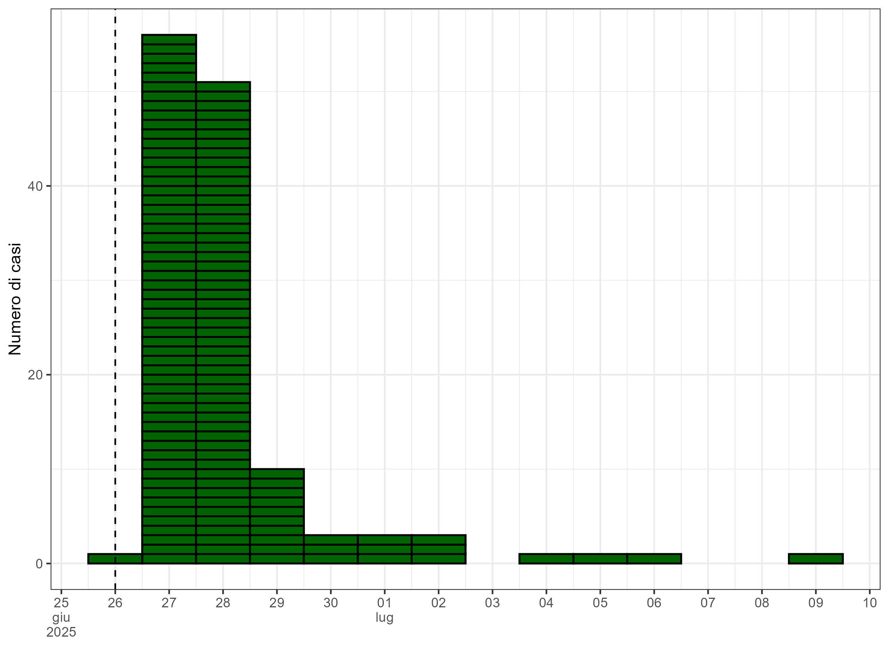

# **Master II livello Epidemiologia - Programmi Statistici**

# Sessione 5 - Analisi descrittiva stratificata e test d'ipotesi:  {.unnumbered}

## Obiettivi di questa sesione


- conoscere ed essere in grado di eseguire i passaggi fondamentali di un'analisi statistica descrittiva 

- essere in grado di eseguire analisi statistiche univariate 

- essere in grado di condurre un'analisi stratificata rispetto a potenziali fattori di rischio e fattori confondenti/modificatori di effetto

### **Preparazione**

Assicurati di avere RStudio aperto con il **progetto *prog_stat_mepi***

### **Scenario, disegno dello studio e piano di analisi**
#### Introduzione

Il 26 giugno 2025, la Università Vita-Salute San Raffaele ha celebrato la festa di laurea della prima edizione del suo Master di II livello in epidemiologia, a cui erano attesi dai 250 ai 350 partecipanti. Tra i partecipanti c'erano i laureati di quella scuola, le loro famiglie e amici, insegnanti, studenti di medicina e alcuni laureati di una università vicina.

Un buffet self-service per la festa è stato fornito da un catering commerciale di Milano. Il cibo è stato preparato il giorno della festa e trasportato in un furgone refrigerato alla scuola.

I festeggiamenti sono iniziati con una cena a buffet aperta dalle 20:30 in poi e sono stati seguiti da un buffet di dessert offerto dalle 22:00. La festa e il buffet si sono protratti fino a tarda notte e le bevande alcoliche sono state molto apprezzate. Tutti hanno convenuto che si trattava di una festa da ricordare.

#### L'allarme

Il 2 luglio 2025, l'ATS di Milano ha segnalato al Servizio di Epidemiologia della Regione Lombardia e all'ISS di Roma la notifica di numerosi casi di gastroenterite in seguito alla festa di laurea sopra descritta. Sono stati sospettati più di 100 casi tra i partecipanti e alcuni di loro sono stati ricoverati in ospedali vicini. I malati hanno sofferto di febbre, nausea, diarrea e vomito che sono durati diversi giorni. La maggior parte ha ritenuto che il tiramisù consumato a cena fosse responsabile della loro malattia. La Salmonella Enteritidis è stata isolata da 19 campioni di feci.

L'ATS di Milano ha inviato un team per esaminare le strutture della cucina del catering. Sono state esaminate le procedure di preparazione del cibo. I campioni di cibo, ad eccezione del tiramisù (non è rimasto nulla), sono stati inviati al laboratorio regionale di riferimento. 

L'ATS di Milano, con il supporto regionale e dell'ISS ha cominciato l'indagine per valutare l'entità dell'epidemia e identificare potenziali veicoli e fattori di rischio per la trasmissione, al fine di controllare meglio il focolaio.

#### Lo studio

I casi sono stati definiti come qualsiasi persona che avesse partecipato alla festa e che avesse sofferto di diarrea (≥ 3 feci liquide o semi-formate in 24 ore) tra il 27 giugno e il 29 giugno 2025; o che avesse sofferto di almeno tre dei seguenti sintomi: vomito, febbre ≥38,5°C, nausea, dolore addominale e mal di testa.

Agli studenti di entrambe università che hanno partecipato alla festa è stato chiesto tramite interviste telefoniche di fornire i nomi delle persone che hanno partecipato alla festa.

In totale, 291 hanno risposto al questionario e sono stati identificati 103 casi (tasso di attacco: 35%). Tra questi casi, 84 (82%) hanno ricevuto cure mediche e quattro sono stati ricoverati in ospedale. I tassi di attacco per fascia d'età erano del 36,6% per le persone <20 anni, del 32,1% per le persone dai 20 ai 29 anni e del 36,8% per le persone di età superiore ai 29 anni.




Utilizzando l'elenco aggiornato dei partecipanti, si vuole fare uno **studio di coorte retrospettivo** includendo tutti i partecipanti alla festa. I partecipanti che hanno risposto alla chiamata hanno ricevuto un questionario standard che chiedeva informazioni demografiche, segni, sintomi e durata, ricovero in ospedale e consumo di cibo e bevande alla festa, inclusa la quantità consumata. Sono stati calcolati tassi di attacco specifici per cibo per oltre 50 alimenti e bevande.

Lo studio dovrò seguire questi passaggi:

**Eseguire la pulizia dei dati**

- Per ciascuna variabile, esaminare l'intervallo, i valori inattesi e mancanti.

**Descrivere ogni variabile**

- Per ogni variabile, descrivere le distribuzioni di frequenza, inclusi i valori mancanti e, se necessario, medie, mediana, mode, quartili, deviazione standard, valori anomali

- Creare istogrammi e box plot se appropriato

- Scegliere le caratteristiche rilevanti per descrivere la popolazione

**Identificare la fonte del focolaio, se presente**

- Calcolare i tassi di attacco specifici per alimento

- Esaminare le proporzioni di casi esposti

- Scegliere la misura di associazione appropriata

- Scegliere i test statistici appropriati e il livello di significatività

- Calcolare le percentuali di casi esposti a ciascuna esposizione

- Cercare qualsiasi relazione dose-risposta, se appropriato

- Interpretare i risultati

**Eseguire un'analisi stratificata**

- Identificare le variabili che sono potenziali modificatori dell'effetto (EM) e fattori confondenti

- Progettare tabelle di stratificazione appropriate

- Stratificare su ciascun livello assunto dall'EM e dai fattori confondenti

- Calcolare le misurazioni appropriate per identificare i fattori confondenti e la modifica dell'effetto

- Condurre test statistici appropriati

- Interpretare i risultati


### **Step 1: Set up**

**Compiti:**

-   Scaricare la cartella *tiramisu_unisr* ed estrarre i contenuti
-   Crea un progetto di RStudio dentro la cartella *tiramisu_unisr*
-   Care uno script di R, assicurati di includere all'inizio dello script nome e
    cognome; obiettivo dello script; tua email e la data. 
-   Comincia per istallare e caricare questi pachetti: rio, skimr, janitor, gtsummary,
rstatix, epitools, epiR, epikit, EpiStats and tidyverse

<details>

<summary style="text-decoration: underline; color: red;">

`r fontawesome::fa("check", fill = "red")`Click to see a solution (try
it yourself first!)

</summary>

</br>

```{r , echo=TRUE, results = 'hide'}
## Programmi Statistici - MEPI
## Autore: Alberto Mateo Urdiales
## Obiettivo: Indagine epidemiologica su focolaio di gastroenterita UNISR
## Contatto: alberto.mateourdiales@iss.it
## Data ultimo aggiornamento: 21 marzo 2025

pacman::p_load(
  
  rio,             # to import datasets
  skimr,           # for displaying your data
  janitor,         # a package for data cleaning
  gtsummary,       # to create frequency tables
  rstatix,         # to generate summary statistics
  epitools,        # for univariable analysis
  epikit,          # for creating age categories
  epiR,            # for the adjusted risk ratios across strata
  EpiStats,        #load EpiStats package for univariable and stratified analysis
  tidyverse        # data management and visualization
)

```

</br>

</details>

### **Step 2: Leggere ed esplorare i dati**

```{r, include=FALSE}
tira_grezzo <- import("../sessioni/prog_stat_mepi/data/tiramisu_unisr.txt")
```

#### 2.1: Leggere i dati 
**Compiti** 

-   Importa il database chiamato *tiramisu_unisr.txt* dentro della sottocarella "data". 


<details>

<summary style="text-decoration: underline; color: red;">

`r fontawesome::fa("check", fill = "red")`Click to see a solution (try
it yourself first!)

</summary>

</br>

```{r , echo=TRUE, eval=FALSE}
# Import the dataset 'tira.csv'  
tira_grezzo <- import("data/tiramisu_unisr.txt") 
```


</br>

</details>


#### 2.2: Esplorare i dati 

**Compito**: Esplora i dati cercando di rispondere a queste domande:


::: {.callout-note appearance="minimal" icon="false"}

**Rispondi!**

::: webex-check
```{r, results="asis", echo=FALSE}
pacman::p_load(webexercises)

opts <- c(
  "522 e 8",
  "2 e 345",
  answer = "291 e 21",
  "600 e 23"
)


cat("DOMANDA: Quante righe e colonne ha il database??", longmcq(opts))

```
:::

::: {.webex-check}

```{r, results="asis", echo=FALSE}
pacman::p_load(webexercises)

opts <- c(
  answer = "8",
  "14",
  "1",
  "0"
)


cat("DOMANDA: Quanti dati mancanti ci sono nella colonna 'age'?", longmcq(opts))

```
:::

::: {.webex-check}

```{r, results="asis", echo=FALSE}
pacman::p_load(webexercises)

opts <- c(
  "factor",
  answer = "integer",
  "character",
  "logical"
)


cat("DOMANDA: Qual è la classe della variabile 'salmon'?", longmcq(opts))

```
:::

::: {.webex-check}

```{r, results="asis", echo=FALSE}
pacman::p_load(webexercises)

opts <- c(
  "83,7%",
  "70,3",
  answer = "28,5%",
  "6%"
)


cat("DOMANDA: Che percentuale di partecipanti ha mangiato 'tomato'?", longmcq(opts))

```
:::

::: {.webex-check}

```{r, results="asis", echo=FALSE}
pacman::p_load(webexercises)

opts <- c(
  "factor",
  "character",
  answer = "date",
  "numeric"
)


cat("DOMANDA: Qual è la classe della colonna 'dateonset'?", longmcq(opts))

```
:::

::: {.webex-check}

```{r, results="asis", echo=FALSE}
pacman::p_load(webexercises)

opts <- c(
  "Come 'NA'",
  "Come celle vuote",
  "Con la categoria 'Unknown'",
  answer = "Con il numero 9"
)


cat("DOMANDA: Come sono categorizzati i valori mancanti nelle variabili 'salmon', 'horseradish' e 'pork'?", longmcq(opts))

```
:::
:::

<details>

<summary style="text-decoration: underline; color: darkgreen;">

`r fontawesome::fa("lightbulb", fill = "gold")` Click to read a hint

</summary>

</br>

Un modo efficiente per esplorare i dati è usare la funzione `skim()` dal pacchetto {skimr}, poiché fornisce tutte le informazioni necessarie con un solo comando. Naturalmente, ci sono diverse alternative. Puoi anche dare un'occhiata a `glimpse()` da {dplyr}, ad esempio.
Un modo semplice per esplorare singole variabili che hanno categorie è usare `tabyl()` da {janitor}
</br>

</details>


<details>

<summary style="text-decoration: underline; color: red;">

`r fontawesome::fa("check", fill = "red")`Click to see a solution (try
it yourself first!)

</summary>

</br>

```{r , echo=TRUE}
# Inspect your dataset and generate basic statistics using the skim function  
skim(tira_grezzo)
# Glimpse is an alternative to skim which gives more accurate information about the nature of the  variables
glimpse(tira_grezzo)
# To see the different categories of the variables
tabyl(tira_grezzo, tomato)

```


</br>

</details>


#### 2.3: Esplorare 'age' in modo più dettagliato 

**Compito** Esplora l'età dei partecipanti (colonna 'age') per:

- Ottenere statistiche riassuntive

- Generare un boxplot dell'età in base allo stato di malattia.


<details>

<summary style="text-decoration: underline; color: darkgreen;">

`r fontawesome::fa("lightbulb", fill = "gold")` Click to read a hint

</summary>

</br>

Puoi creare un boxplot con {ggplot2} usando la geom `geom_boxplot()`. Per creare due box, uno per ogni stato di malattia, puoi assegnare nell'estetica la colonna *ill* sia all'asse x che al riempimento. Non preoccuparti se non ti sembra bello... dovrebbe essere come la soluzione riportata sotto. Se hai bisogno di un ripasso su come funziona ggplot, dai un'occhiata al  [Capitolo](https://epirhandbook.com/new_pages/ggplot_basics.html) dell'EpiRhandbook

</br>

</details>


<details>

<summary style="text-decoration: underline; color: red;">

`r fontawesome::fa("check", fill = "red")`Click to see a solution (try
it yourself first!)

</summary>

</br>

```{r , echo=TRUE, warning=TRUE}
## Generate summary statistics 
summary(tira_grezzo$age)

### Creating a boxplot of age by illness status
boxplot_eta <- tira_grezzo %>% 
  
  ggplot(mapping = aes(x = ill,
                       y = age,
                       fill = ill)) + 
  
  geom_boxplot() + 
  
  labs(
    title = "Boxplot: Distribuzione dell'età per stato di salute",
    x = "Stato di salute",
    y = "Età",
    fill = "Malattia (0=No;1=Sì)"
  ) +
  
  theme_bw()

boxplot_eta
```

</br>

</details>


::: {.callout-note appearance="minimal" icon="false"}  

**Rispondi!**  

::: webex-check
```{r, results="asis", echo=FALSE}
pacman::p_load(webexercises)

opts <- c(
  "No ill",
  "Ill",
  answer = "Impossibile di sapere con questo boxplot"
)


cat("DOMANDA: Guardando il boxplot, quale gruppo (ill o no-ill) ha una maggior variazione dei dati in torno alla mediana di età?", longmcq(opts))

```
:::
::: 

Non siamo riusciti a creare il boxplot che volevamo. Infatti, puoi vedere che è apparso un messaggio di avviso nella tua console che dice: "Did you forget to specify a `group` aesthetic or to convert a numerical variable into a factor?"

Sembra che tutte le colonne che consistono di valori 1 (presenti) e 0 (assenti) siano di classe 'integer', anche "ill". Integer significa che sono considerati numeri. Tuttavia, noi vogliamo che siano categorie, altrimenti non saremo in grado di eseguire molte delle analisi che vogliamo (incluso questo boxplot). Quindi, ora risolveremo questo problema insieme ad altre operazioni di pulizia.  

### **Step 3: Pulizia dei dati**

#### 3.1: Transform categorical variables
**Compito**: Change all present (1) / absent (0) variables from integer to factors. Do the same for the variables that record the number of portions eaten.

<details>

<summary style="text-decoration: underline; color: darkgreen;">

`r fontawesome::fa("lightbulb", fill = "gold")` Click to read a hint

</summary>

</br>

You can do this one by one, or you could do all at the same time using the `across()` function from {dplyr}. If you are not sure how to use the `across()` function, read the section on [Transform multiple columns](https://epirhandbook.com/en/new_pages/cleaning.html#clean_across) from the EpiRhandbook.
</br>

</details>

<details>

<summary style="text-decoration: underline; color: red;">

`r fontawesome::fa("check", fill = "red")`Click to see a solution (try
it yourself first!)

</summary>

</br>

```{r , echo=TRUE}
tira_clean <- tira_grezzo %>% # tira_clean will be out clean dataframe after we have performed cleaning Compiti on tira_grezzo
  
  # this would be changing one-by-one the columns into numeric variables
  mutate(ill = as.numeric(ill)) %>% 
  
  # this would change all columns we are interested into 'numeric variables' in only one command
  mutate(across(.cols = !c(uniquekey, dateonset, age), # with the exclamation mark before c() we are telling R that we want all columns, except those in the c() list, to be transformed into factors
                .fns = ~ as.numeric(.x)))


# Check that the changes have been succesful
glimpse(tira_clean)
```


</br>

</details>

#### 3.2: Categorise "missing" as NA
We saw with the `skim()` overview -and in the data dictionary- that the variables *salmon*, *pork* and *horseradish* have 'missing' codified with number '9'. In most analysis and visualisations, it is very important that R considers missing data truly as "missing". To do that, missing data needs to be coded as NA (**without quotes**). Other codifications of missing data, such as empty spaces or the number 9 (as in this case) will mean that R will treat this data as a category or a number. For R, 9 is not different from number 1.

**Compito** Recode the columns salmon, pork and horseradish so that values of 9 are coded as NA. Add the new code to the cleaning pipeline initiated in the previous step

<details>

<summary style="text-decoration: underline; color: darkgreen;">

`r fontawesome::fa("lightbulb", fill = "gold")` Click to read a hint

</summary>

</br>

For this Compito you can use the `mutate()` function in combination with `case_match()` or `if_else()`. The former is used specifically for recoding, whereas the latter is used to create/modify columns based on logical conditions. In any case, functions like `if_else()` and `case_match()` may require you to specify the type of NA (e.g., NA_character_, NA_real_, NA_integer_) to ensure that the resulting vector maintains a consistent data type. This is important because R is strongly typed, meaning that each vector must contain elements of the same type.
If you want to know more about recoding, read the EpiRhandbook section on [Recoding](https://epirhandbook.com/new_pages/cleaning.html#re-code-values). Regardless of the approach that you choose, add it to the cleaning pipe command you started before, so that your code is tidy.
</br>

</details>


<details>

<summary style="text-decoration: underline; color: red;">

`r fontawesome::fa("check", fill = "red")`Click to see a solution (try
it yourself first!)

</summary>

</br>

```{r , echo=TRUE}
tira_clean <- tira_grezzo %>% 
  # tira_clean will be our clean dataframe after we have performed cleaning Compiti on tira_grezzo
  
  # this would be changing one-by-one the columns into numeric variable
  mutate(ill = as.numeric(ill))
  
  tira_clean <- tira_clean %>% 
  # this would change all columns we are interested in into 'numeric variables' in only one command
  mutate(across(.cols = !c(uniquekey, dateonset, age), 
                # with the exclamation mark before c() we are telling R that we want all columns, except those in the c() list, to be transformed into factors
                .fns = ~ as.numeric(.x))) 
 
  tira_clean <- tira_clean %>% 
  # we can do all columns at the same time with across(). Here we use case_match for this example
  mutate(across(.cols = c(salmon, horseradish, pork), 
                .fns = ~ case_match(.x, 
                                    9 ~ NA_integer_,
                                    .default = .x)))

# Check that the changes have been successful
tabyl(tira_clean, salmon)
tabyl(tira_clean, horseradish)
tabyl(tira_clean, pork)
```


</br>

</details>

#### 3.3: Re-categorise mousse and tiramisu portions
We saw that there are two columns -*tportion* and *mportion*- that have four categories according to the number of portions eaten. However, exploring these columns we can see that few people ate 3 portions. The low number in this category means that it will be very difficult to have meaningful results due to the wide uncertainty that we'll find in the estimates.

**Compito**: Re-categorise these columns so that they have three categories: 0,1 and 2+ portions eaten. Add the new code to the cleaning pipeline initiated previously. 

<details>

<summary style="text-decoration: underline; color: darkgreen;">

`r fontawesome::fa("lightbulb", fill = "gold")` Click to read a hint

</summary>

</br>

We will now use the `mutate()` function in combination with `if_else()`. As specified above, this function is used for simple logical recoding, which is what we want to do now. There are three "partner" functions called `if_else()` from {dplyr}, `ifelse()` from {base} and `fifelse()` from {data.table}. They all have the same syntax. `ifelse()` has the advantage of being embedded in R, which guarantees its stability and sustainability. `if_else()` has some advantages compared to `ifelse()` that are important in epi analysis. For example, it does not convert Date objects to numeric (which can be a headache) and verifies that both alternatives in the if and else statements are of the same class. Finally, `fifelse()` is the fastest, so it has its advantages when we're analysis a large database.

If you want to know more about simple logical recoding, have a look at the dedicated [section](https://epirhandbook.com/new_pages/cleaning.html#ifelse-and-if_else) of the EpiRhandbook.

</br>

</details>

<details>

<summary style="text-decoration: underline; color: red;">

`r fontawesome::fa("check", fill = "red")`Click to see a solution (try
it yourself first!)

</summary>

</br>

```{r , echo=TRUE}
#Check portion before
tabyl(tira_clean, tportion)
tabyl(tira_clean, mportion)

#Run cleaning pipe line with new code
tira_clean <- tira_grezzo %>% # tira_clean will be out clean dataframe after we have performed cleaning Compiti on tira_grezzo
  
  # this would be changing one-by-one the columns into numeric variable
  mutate(ill = as.numeric(ill)) %>% 
  
  # this would change all columns we are interested into 'numeric variables' in only one command
  mutate(across(.cols = !c(uniquekey, dateonset, age), # with the exclamation mark before c() we are telling R that we want all columns, except those in the c() list, to be transformed into factors
                .fns = ~ as.numeric(.x)))
  
tira_clean <- tira_clean %>%
  # we can do all columns at the same time with across(). Here we use case_match for this example 
  mutate(across(.cols = c(salmon, horseradish, pork), 
                .fns = ~ case_match(.x, 
                                    9 ~ NA_integer_,
                                    .default = .x)))
  tira_clean <- tira_clean %>% 
  # simple logical recoding with if_else()
    mutate(tportion2 = if_else(tportion >= 2, 2, tportion))%>% 
    mutate(mportion2 = if_else(mportion >= 2, 2, mportion))


#Check portion after to verify changes
tabyl(tira_clean, tportion2)
tabyl(tira_clean, mportion2)
```


</br>

</details>

#### 3.4: Create age groups


**Compito**: Create a new variable with two categories (those aged < age's median and those >=age's median). **Add the code to create this new variable to the cleaning command you created above to ensure your code is tidy. Do not write multiple cleaning commands**

<details>

<summary style="text-decoration: underline; color: darkgreen;">

`r fontawesome::fa("lightbulb", fill = "gold")` Click to read a hint

</summary>

</br>

You can  create the age group column with the function `age_categories()` from {epikit}. If you're not familiar with this function, try looking in the *Help* on how it works, or read the specific EpiRhandbook [Section](https://epirhandbook.com/new_pages/cleaning.html#age_categories)
</br>

</details>


<details>

<summary style="text-decoration: underline; color: red;">

`r fontawesome::fa("check", fill = "red")`Click to see a solution (try
it yourself first!)

</summary>

</br>

```{r , echo=TRUE}
tira_clean <- tira_clean %>% # tira_clean will be out clean dataframe after we have performed cleaning Compiti on tira_grezzo
  
  # this would be changing one-by-one the columns into numeric variable
  mutate(ill = as.numeric(ill)) %>% 
  
  # this would change all columns we are interested into 'numeric variables' in only one command
  mutate(across(.cols = !c(uniquekey, dateonset, age), # with the exclamation mark before c() we are telling R that we want all columns, except those in the c() list, to be transformed into factors
                .fns = ~ as.numeric(.x))) 
  
tira_clean <- tira_clean %>% 
  # we can do all columns at the same time with across(). Here we use case_match for this example 
  mutate(across(.cols = c(salmon, horseradish, pork), 
                .fns = ~ case_match(.x, 
                                     9 ~ NA_integer_,
                                    .default = .x))) 
  
 tira_clean <- tira_clean %>% 
  # simple logical recoding with if_else()
    mutate(tportion2 = if_else(tportion >= 2, 2, tportion))%>% 
    mutate(mportion2 = if_else(mportion >= 2, 2, mportion))

  tira_clean <- tira_clean %>%   
  # create age categories
  mutate(age_group = age_categories(age,           # the column to use to create the cateogories 
                                    lower = 0,     # the lower value
                                    upper = 20,    # the upper value (we want a group of 20+)
                                    by = 20))      # as we only want two groups, this is also 20


# Check that the changes have been succesful
tabyl(tira_clean, salmon)
tabyl(tira_clean, tportion2)
tabyl(tira_clean, age_group)
```


</br>

</details>


#### 3.5: Re-create the boxplot
**Compito**: Create the boxplot we tried in **2.3** using the clean version of the data. Save the boxplot in the subfolder "outputs".

<details>

<summary style="text-decoration: underline; color: red;">

`r fontawesome::fa("check", fill = "red")`Click to see a solution (try
it yourself first!)

</summary>

</br>
```{r, echo=TRUE}
## Boxplot of age by illness status
boxplot_age <- tira_clean %>% 
  
  ggplot(mapping = aes(x = ill,
                       y = age,
                       fill = ill)) + 
  
  geom_boxplot() + 
  
  labs(
    title = "Boxplot: Age distribution per disease status",
    x = "Disease status",
    y = "Age",
    fill = "Illness (0=No;1=Yes)"
  ) +
  
  theme_bw()

boxplot_age
```

```{r, echo=TRUE, eval=FALSE}

### Save the boxplot
#### A static way of saving it
ggsave(filename = "outputs/boxplot_age.png", plot = boxplot_age)
#### A dynamic way of doing it so that it contains the date of the analysis
ggsave(filename = str_glue("outputs/boxplot_age_",             #First we write the beginning of the file name until the date 
                           str_replace_all(Sys.Date(), "-", ""),  #Sys.Date() gives us the date of analysis. Str_replace_all() removes all hyphens 
                           ".png"),                               # Finally we add the ending which is the file type
       plot = boxplot_age)
```
</br>

</details>

::: {.callout-note appearance="minimal" icon="false"}  

**Rispondi!**

::: webex-check
```{r, results="asis", echo=FALSE}
pacman::p_load(webexercises)

opts <- c(
  "No ill",
  answer = "Ill",
  "Impossible to know from this boxplot"
)


cat("DOMANDA: Which group (ill or not ill) has more variation around age's median?", longmcq(opts))

```
:::
::: 

#### 3.6: Export the clean data

**Compito**: Export the clean version of the dataset as a csv file and save it in the folder "outputs".

<details>

<summary style="text-decoration: underline; color: red;">

`r fontawesome::fa("check", fill = "red")`Click to see a solution (try
it yourself first!)

</summary>

</br>
```{r, echo=TRUE, eval=FALSE}
# export the dataset

export(tira_clean, "outputs/tira_clean.csv", row.names = F)
```

</br>

</details>


### **Step 4: Descriptive analysis**

Now that we have explored and cleaned our data, we can start with the descriptive analysis. As you know, we normally describe the data by time, person and place. We won't do the "place" analysis because in this outbreak, that element is not relevant.

#### 4.2: Analysis by time

**Compito**: Generate an epidemic curve with the dates of onset. Display in the x-axis each day of the study period.

<details>

<summary style="text-decoration: underline; color: darkgreen;">

`r fontawesome::fa("lightbulb", fill = "gold")` Click to read a hint

</summary>

</br>

You should be able, by now, to create the histogram required for this epicurve. For the x-axis breaks, remember there are two distinct elements in a `ggplot()`. Inside `geom_histogram()` we can specify the `binwidth =` of the bins to the unit we want (e.g, 1 for daily, 7 for weekly etc.). This will change the whole epicurve. 
The second element is the scale. Scales change the way the axis or the colours are displayed, but the epicurve remains the same. In this case, as we want to modify the X-axis which is a date, we should use the function `scale_x_date()` and specify inside that we want `date_breaks =` by "day".
If you are struggling, have a look at the [Epicurves](https://epirhandbook.com/new_pages/epicurves.html#epicurves-with-ggplot2) chapter of the EpiRhandbook.
</br>

</details>

<details>

<summary style="text-decoration: underline; color: red;">

`r fontawesome::fa("check", fill = "red")`Click to see a solution (try
it yourself first!)

</summary>

</br>
```{r, echo=TRUE}
tira_clean %>% 
  
  ggplot(mapping = aes(x = dateonset)) + 
  
  geom_histogram(binwidth = 1,             # we assign the width of the bins to one day
                 color = "darkgreen",      # color of lines around bars
                 fill = "lightgreen" )  +  # color of fill within bars 
  
  scale_x_date(date_breaks = "day") +      # we want each day to be shown in the x-axis
  
  labs(
    title = "Epicurve of cases by date of onset",
    y = "Number of cases",
    x = ""                                 # we leave x-axis title blank because we already say in title it is date of onset
  ) +
  
  theme_bw() +                             # predefined theme
  
  theme(axis.text.x = element_text(angle = 90)) # we change the angle of the days in the x-axis so it is readble. Important this happens at the end

  
```

</br>

</details>

::: {.callout-note appearance="minimal" icon="false"}  

**Rispondi!**

::: webex-check
```{r, results="asis", echo=FALSE}
pacman::p_load(webexercises)

opts <- c(
  "48h",
  "A week later",
  answer = "24h",
  "The day of the party"
)


cat("DOMANDA: How long after the party was the peak day in cases?", longmcq(opts))

```
:::
::: 

#### 4.3: Analysis by person

**Compito**: Generate 2-by-2 tables with sex and age group by illness status

<details>

<summary style="text-decoration: underline; color: darkgreen;">

`r fontawesome::fa("lightbulb", fill = "gold")` Click to read a hint

</summary>

</br>

There are several approaches to generate descriptive tables and cross-tabulations. You could use `tabyl()` from {janitor}, which is a very fast approach; or you could use `group_by()` in combination with `summarise()`, from {dplyr} which is the most flexible. In this case, however, we show you the solution with a very efficient approach: `tbl_summary()` from {gtsummary}
</br>

</details>

<details>

<summary style="text-decoration: underline; color: red;">

`r fontawesome::fa("check", fill = "red")`Click to see a solution (try
it yourself first!)

</summary>

</br>
```{r, echo=TRUE}
tira_clean %>% 
  
  select(sex, age_group, ill) %>%  # we select the columns we're interested in
  
  tbl_summary(by = ill, percent = "row") # we assign the grouping column and define that we want the percentages by row to estimate attack rates by sex and age group.
```

</br>

</details>

::: {.callout-note appearance="minimal" icon="false"}  

**Rispondi!**

::: webex-check
```{r, results="asis", echo=FALSE}
pacman::p_load(webexercises)

opts <- c(
  answer = "33%",
  "39%",
  "45%",
  "80%"
)


cat("DOMANDA: What was the attack rate in females?", longmcq(opts))

```
:::
::: 

### **Step 5: Develop and test hypothesis**

In the previous step we have described the number of ill attendees by date of onset, and we have described how sex and age were distributed according to illness status. The next step in an outbreak investigation would be to develop and test hypothesis about the possible source of the outbreak.

#### 5.1: Compute food-specific attack rates and % of cases exposed

**Compito**: Create 2 by 2 tables with exposure and outcome and calculate the attack rates.

<details>

<summary style="text-decoration: underline; color: darkgreen;">

`r fontawesome::fa("lightbulb", fill = "gold")` Click to read a hint

</summary>

</br>

You could use the same approach we used before with `tbl_summary()` from {gtsummary}, but to calculate attack rates, you'll need to change from column to row percentages.
</br>

</details>

<details>

<summary style="text-decoration: underline; color: red;">

`r fontawesome::fa("check", fill = "red")`Click to see a solution (try
it yourself first!)

</summary>

</br>
```{r, echo=TRUE}
tira_clean %>% 
  
  select(tira, wmousse, dmousse, wmousse, beer, 
         redjelly, fruitsalad, tomato, mince, salmon,
         horseradish, chickenwin, roastbeef, pork, ill) %>% # we select the columns we're interested in
  
  tbl_summary(by = ill, percent = "row") %>% #we assign the grouping column and define that we want the percentages by row
  
  add_overall()    # we add the overall counts
```

</br>

</details>

::: {.callout-note appearance="minimal" icon="false"}  

**Rispondi!**

::: webex-check
```{r, results="asis", echo=FALSE}
pacman::p_load(webexercises)

opts <- c(
  "39%",
  "25%",
  "78%",
  answer = "68%"
)


cat("DOMANDA: What is the attack rate in those who ate white mousse?", longmcq(opts))

```
:::
::: 

#### 5.2: Estimate the relative risk of the different exposures

We have calculated attack rates in exposed and unexposed, which already gives us a lot of information. For example, we see little difference in the attack rates of those who ate and did not ate salmon; but we observe a much higher attack rate among those who ate tiramisu, than among those who did not eat it. We also see a higher attack rate in those who did not drink beer than in those who drank it.

To have a better understanding of the exposures, we will now calculate relative risks.

**Compito**: First, estimate the relative risk for the exposure of having eaten white mousse at the dinner

<details>

<summary style="text-decoration: underline; color: darkgreen;">

`r fontawesome::fa("lightbulb", fill = "gold")` Click to read a hint

</summary>

</br>

You could do this manually, but you could use one of the following functions: 1) the function `CS()`  (for Cohort Study) or `CC()` (for Case-control Study) from the {EpiStats} package. For this function to work, the outcome and exposure variables have to be numeric and dichotomous coded as 1 (yes) and 0 (no); first write the database_name, then the outcome variable and then the exposure variable, 2) the function `riskratio()` from the package {epitools}, which will give you the RRs and  95%CIs even if you have >2 exposure categories. In this function, you need first to write the exposure and then the outcome. Try reading the documentation of those functions if you have any doubts.

</br>

</details>

<details>

<summary style="text-decoration: underline; color: red;">

`r fontawesome::fa("check", fill = "red")`Click to see a solution (try
it yourself first!)

</summary>

</br>
```{r, echo=TRUE}
# Relative risk wmousse
EpiStats::CS(tira_clean, "ill", "wmousse") 
riskratio(tira_clean$wmousse, tira_clean$ill)

# Relative risk tiramisu
EpiStats::CS(tira_clean, "ill", "tira") 
riskratio(tira_clean$tira, tira_clean$ill)
```

</br>

</details>

::: {.callout-note appearance="minimal" icon="false"}  

**Rispondi!**

::: webex-check
```{r, results="asis", echo=FALSE}
pacman::p_load(webexercises)

opts <- c(
  "2.1",
  "179",
  answer = "2.8",
  "1.0"
  )


cat("DOMANDA: What is the risk of illness among those who ate white mousse compared to those who did not have this food ?", longmcq(opts))

```
:::
::: 

**Compito**: Calculate now the risk ratio for all the other exposures to develop hypothesis of the possible source

<details>

<summary style="text-decoration: underline; color: darkgreen;">

`r fontawesome::fa("lightbulb", fill = "gold")` Click to read a hint

</summary>

</br>

You could write the `CS()` or `riskratio()` functions changing the exposure variable one by one. However, to save time and avoid making errors, you could try the `CSTable` function from from the {EpiStats} package.

You could also use approaches that allow you to apply the same function to many different objects (e.g., multiple columns) simultaneously. There are different options for this such as *loops*, *lapply* or *purrr*. Here we give the solution with *purrr*, so if you want to explore further purrr have a look at the dedicated [section](https://epirhandbook.com/new_pages/iteration.html#iter_purrr) in the EpiRhandbook.
</br>

</details>


<details>

<summary style="text-decoration: underline; color: red;">

`r fontawesome::fa("check", fill = "red")`Click to see a solution (try
it yourself first!)

</summary>

</br>
```{r, echo=TRUE}
# Relative risk of the rest of variables with EpiStats::CSTable
# Create an object of all the food variable
food_variables <- c("tira","wmousse",   
                    "dmousse","beer","redjelly","fruitsalad",
                    "tomato","mince","salmon",
                    "horseradish", "chickenwin",
                    "roastbeef","pork")

#Create a table for all the food variables together
CSTable (tira_clean, "ill", food_variables)

#Another option
tira_clean %>% 
  select(-uniquekey, -age, -age_group, -sex, -dateonset, -ill) %>% # we first remove the columns we're not interested + the outcome column
  map(.f = ~riskratio(.x, tira_clean$ill))     # here we call the function for each column. ".x" represents all the columns in the database that have not been removed previously

# Calculate Risk ratios for each portion of tiramisu and mousse consumption.
riskratio(tira_clean$tportion2, tira_clean$ill)
riskratio(tira_clean$mportion2, tira_clean$ill)

```

</br>

</details>

::: {.callout-note appearance="minimal" icon="false"}  

**Rispondi!**

::: webex-check
```{r, results="asis", echo=FALSE}
pacman::p_load(webexercises)

opts <- c(
  "beer",
  answer = "tiramisu",
  "pork",
  "dark mousse"
  )


cat("DOMANDA: Which exposure has the highest risk ratio?", longmcq(opts))

```
:::


::: webex-check
```{r, results="asis", echo=FALSE}
pacman::p_load(webexercises)

opts <- c(
  answer ="beer",
  "tiramisu",
  "pork",
  "dark mousse"
  )

cat("DOMANDA: Which of the following seems like a protective factor?", longmcq(opts))

```
:::

::: webex-check
```{r, results="asis", echo=FALSE}
pacman::p_load(webexercises)

opts <- c(
  "beer",
  "tiramisu",
  answer = "pork",
  "dark mousse"
  )

cat("DOMANDA: Which of the following has a non-significant association?", longmcq(opts))

```
:::

::: webex-check
```{r, results="asis", echo=FALSE}
pacman::p_load(webexercises)

opts <- c(
  answer = "Yes",
  "No"
  )

cat("DOMANDA: Is there a dose-response in the association between illness and tiramisu?", longmcq(opts))

```
:::
::: 

Several food items seemed to be associated with the occurrence of illness; **tiramisu, dark and white chocolate mousse, fruit salad, and red jelly**. They can potentially explain up to 94, 76, 49, 46, and 45 of the 103 cases, respectively. Investigators decided to identify their respective roles in the occurrence of illness. There also seems to be a **dose-response** in the amount of tiramisu eaten, with those eating 2 or more portions having a higher risk than those eating only 1 (who had a higher risk than those who did not eat tiramisu)

From the crude analysis, epidemiologists noticed that the occurrence of **gastroenteritis was lower among those attendants who had drunk beer.** They also decided to assess if beer had a protective effect on the occurrence of gastroenteritis.

#### 5.3: Stratified analysis- Confounding and effect modification

The finding that beer had a protective effect on GI illness is surprising. One of your colleagues suggested that tiramisu might be confounding this association. Given that tiramisu has the highest risk ratio, it might be that the dessert is associated with the outcome (causes it) and to the exposure (those drinking beer might have preferred not to ruin its sour flavour with the sweetness of tiramisu). Another colleague disagrees and thinks that, actually, tiramisu might be an effect modifier in the relation between beer and illness.

DOMANDA: How would you check if tiramisu is a confounder or an effect modifier in the association between beer and illness? 


<details>

<summary style="text-decoration: underline; color: red;">

`r fontawesome::fa("check", fill = "red")`Click to see a solution (try
it yourself first!)

</summary>

</br>

To check both things: confounding and effect modification, we should stratify our data by tiramisu consumption. Once stratified, we can calculate risk ratios in both strata and an adjusted risk ratio: **the adjusted Mantel–Haenszel risk ratio**. If this risk ratio is very different from the crude risk ratio (the overall risk ratio between beer and illness), we could say that tiramisu confounds the association between beer and illness. We normally define as "very different" when: $(RRcrude/RRadjusted - 1)*100$ is larger than 10-20% difference (no strict threshold, your interpretation and expertise counts!).

If there is confounding but no effect modification, the adjusted M-H risk ratio should be different from the crude RR, but **the risk ratios in each strata -tiramisu yes and tiramisu no- should not be different**. If they are  different then there is **effect modification**. How do we know if they aredifferent? We can run a test to tell us that called **the Mantel–Haenszel test of homogeneity**.
</br>

</details>


**Compito**: Check if tiramisu is a confounder or an effect modifier in the association between beer and illness

Try doing this Compito with the function `csinter()` from the {EpiStats} package. **Read the documentation of the function**.

<details>

<summary style="text-decoration: underline; color: darkgreen;">

`r fontawesome::fa("lightbulb", fill = "gold")` Click to read a hint

</summary>

</br>


</br>

</details>


<details>

<summary style="text-decoration: underline; color: red;">

`r fontawesome::fa("check", fill = "red")`Click to see a solution (try
it yourself first!)

</summary>

</br>
```{r, echo=TRUE}
#Stratify by tiramisu; let's try exposure=white mousse first
tira_wmousse <- csinter(x = tira_clean, 
                        cases = "ill", 
                        exposure = "wmousse", 
                        by = "tira")

tira_wmousse

#Stratify by tiramisu; exposure=beer
tira_beer <- csinter(x = tira_clean, 
                     cases = "ill", 
                     exposure = "beer", 
                     by = "tira")

tira_beer

#Stratify by tiramisu portion; exposure=beer
tportion_beer <- csinter(x = tira_clean, 
                         cases = "ill", 
                         exposure = "beer", 
                         by = "tportion2")

tportion_beer
```

</br>

</details>

::: {.callout-note appearance="minimal" icon="false"}  

**Rispondi!**

::: webex-check
```{r, results="asis", echo=FALSE}
pacman::p_load(webexercises)

opts <- c(
  answer = "13%",
  "87%",
  "30%",
  "20%"
  )

cat("DOMANDA: Look at the results, what's the magnitude of the difference between the adjusted MH risk ratio and the crude one?", longmcq(opts))

```
:::

::: webex-check
```{r, results="asis", echo=FALSE}
pacman::p_load(webexercises)

opts <- c(
   "No",
  answer ="Yes"
  )

cat("DOMANDA: Look at the results, is tiramisu an effect modifier in the association between beer and illness?", longmcq(opts))

```
:::
:::

You got several results. Let's now review them to make sense of them:


To check if there is confounding, we need to evaluate if the crude and the adjusted risk ratios are very different. We said that we can do that with the formula $(RRcrude/RRadjusted - 1)*100$. Here, the **Inc risk ratio (crude:M-H):** corresponds to the first part: $RRcrude/RRadjusted$. So we need to substract 1 and multiple by 100: (0.87-1)*100. If you do that you'll get 13%, which is borderline, but we can say that tiramisu is not massively confounding the association between beer and illness.

To know whether there is effect modification, you can check the **the two stratum-specific risk ratios**. As they are very different (0.8 vs 1.0), we can conclude there is effect modification of tiramisu on the association between beer and illness.This suggests that the consumption of beer has reduced the effect of tiramisu on gastroenteritis.

We can perform a similar stratification  assessing dose response for tiramisu consumption among beer drinkers and not. After stratifying by the amount of tiramisu consumed, it appears that beer reduces the effect of tiramisu on gastroenteritis only among those who have eaten an average amount of tiramisu. This indicates that, if the amount of tiramisu is large, beer is no longer a protective factor of gastroenteritis.

How would you proceed with your analysis? (to be continued during the MVA module)

### **Case study information** 

***Authorship***\
Original authors: This case study was first designed by Alain Moren and
Gilles Desve for EPIET. It is based on an investigation conducted by
Anja Hauri, RKI, Berlin, 1998.\
Data source: Data is fictional and was inspired by [Nygren et al.
Tick-borne encephalitis: acute clinical manifestations and severity in
581 cases from Germany, 2018-2020. Journal of Infection. 2023 Apr
1;86(4):369-75](https://linkinghub.elsevier.com/retrieve/pii/S0163-4453(23)00088-9)\
Adapted and modified by: Alicia Barrasa (EPIET), Ioannis Karagiannis
(Public Health England - PHE), Giri Shankar (Public Health Wales),
Niklas Willrich (Robert Koch Institute-RKI), Patrick Keating (Austrian
Agency for Health and Food Safety-AGES), Alexander Spina (AGES), Daniel
Gardiner (PHE), Lukas Richter (AGES), Liese Van Gompel (MedEPIET),  Kostas Danis (MedEPIET) and Alberto Mateo Urdiales
(Istituto Superiore di Sanità - ISS)\


#### Terms of Use

**Disclaimer**: The information presented in this exercise and the
associated data files have been deliberately changed so as to facilitate
the acquisition of the learning objectives for fellows of EPIET, EUPHEM
and EPIET-associated programmes. This case study was first introduced in
2022 (see Copyright and Licence agreement for more information).

You are free:

-   to Share: to copy and distribute the work
-   to Remix: to adapt and build upon the material

Under the following conditions:

-   Attribution: You must attribute the work in the manner specified by
    the author or licensor (but not in any way that suggests that they
    endorse you or your use of the work). The best way to do this is to
    keep as it is the list of contributors: sources, authors and
    reviewers.

-   Share Alike: If you alter, transform, or build upon this work, you
    may distribute the resulting work only under the same or similar
    license to this one. Your changes must be documented. Under that
    condition, you are allowed to add your name to the list of
    contributors.

-   Notification: If you use the work in the manner specified by the
    author or licensor, [Walter\@rki.de](mailto:Walterj@rki.de)

-   You cannot sell this work alone but you can use it as part of a
    teaching.

With the understanding that:

-   Waiver: Any of the above conditions can be waived if you get
    permission from the copyright holder.

-   Public Domain: Where the work or any of its elements is in the
    public domain under applicable law, that status is in no way
    affected by the license.

-   Other Rights: In no way are any of the following rights affected by
    the license:

    -   Your fair dealing or fair use rights, or other applicable
        copyright exceptions and limitations;

    -   The author's moral rights;

    -   Rights other persons may have either in the work itself or in
        how the work is used, such as publicity or privacy rights.

-   Notice: For any reuse or distribution, you must make clear to others
    the license terms of this work by keeping together this work and the
    current license.

This licence is based on
<http://creativecommons.org/licenses/by-sa/3.0/>

#### Feedback & suggestions

-   You can write feedback and suggestions on this case study at the
    ECDC GITHUB
-   Alternatively email us at: \[ECDC CONTACT MAIL\]

\pagebreak

#### Version and revisions

Write date of first version

Write any revisions made to the case study

| Date | Changes made                                                                                                                                                                                                                                       |                                                                                                                                    Author |
|---------------------|:-------------------------------|------------------:|
| 2015 | The case study has been divided in two parts: the first includes descriptive, univariable and stratified analysis as pre-module homework; the second includes logistic and binary regression (not shown here). Unnecessary toponymes were removed. |                                                               Alicia Barrasa (EPIET) and Ioannis Karagiannis (Publich Health England-PHE) |
| 2017 | Questions were rephrased to reflect real life scenarios (rather than academic exercise)                                                                                                                                                            |                                                                         Alicia Barrasa (EPIET) and Giri Shankar (Public Health Wales-PHW) |
| 2017 | The case study was adapted to include the help on R                                                                                                                                                                                                | Niklas Willrich (Robert Koch Institute-RKI), Patrick Keating (Austrian Agency for Health and Food Safety-AGES) and Alexander Spina (AGES) |
|2017| Contribution to the R code|Daniel Gardiner (Public Health England-PHE) and Lukas Richter (AGES)|
|2022|Minor revisions to the R code and explanations| |
|2023| Major revision of the R code. R code was simplified and R tidyverse code was implemented| Liese Van Gompel (MedEPIET)|
|2024| Revision of the R code, i.e. use of EpiStat package for univariable and multivariable analysis, simplification and harmonisation of the R code| Kostas Danis (MediPIET)|
| 2024 | Revision of content, structure, R code and adaptation of format to Applied Epi's template of case studies | Alberto Mateo Urdiales (ISS) |
| 2025 | Revision of contents |  Felix Moek (RKI, ECDC)


