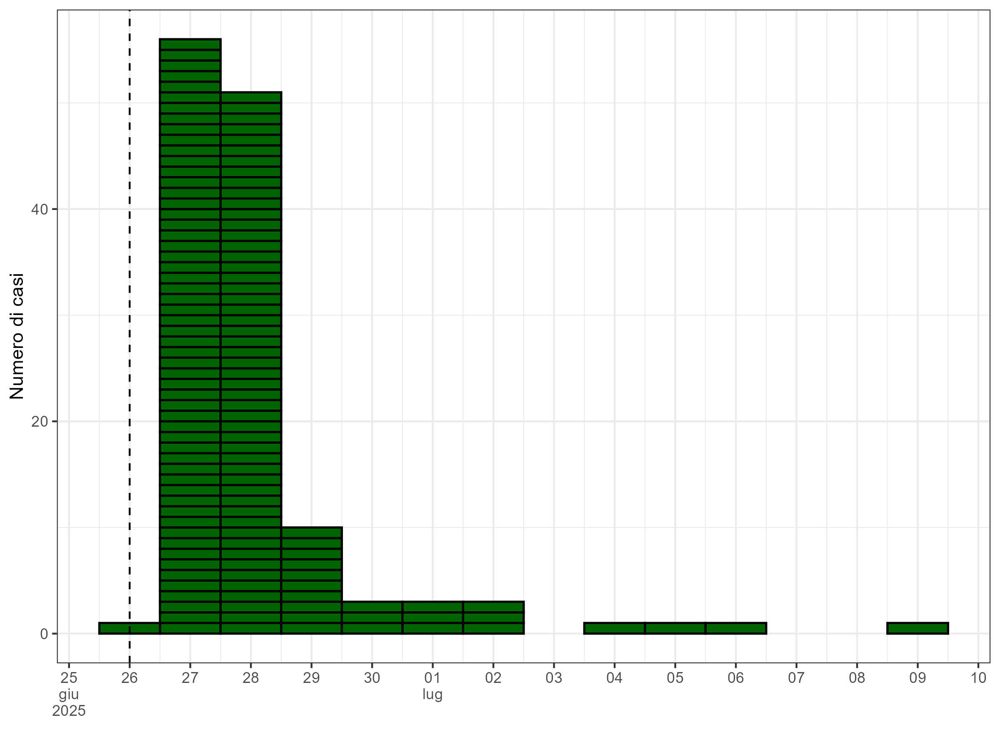

# **Master II livello Epidemiologia - Programmi Statistici**

# Sessione 5 - Analisi descrittiva stratificata e sviluppo d'ipotesi:  {.unnumbered}

## Obiettivi di questa sesione


- conoscere ed essere in grado di eseguire i passaggi fondamentali di un'analisi statistica descrittiva 

- essere in grado di eseguire analisi statistiche univariate 

- essere in grado di condurre un'analisi stratificata rispetto a potenziali fattori di rischio e fattori confondenti/modificatori di effetto


### **Scenario, disegno dello studio e piano di analisi**
#### Introduzione

Il 26 giugno 2025, la Università Vita-Salute San Raffaele ha celebrato la festa del finale della prima edizione del suo Master di II livello in epidemiologia, a cui erano attesi dai 250 ai 350 partecipanti. Tra i partecipanti c'erano gli studenti di quella università, le loro famiglie e amici, insegnanti, studenti di medicina e alcuni laureati di una università vicina.

Un buffet self-service per la festa è stato fornito da un catering commerciale di Milano. Il cibo è stato preparato il giorno della festa e trasportato in un furgone refrigerato alla scuola.

I festeggiamenti sono iniziati con una cena a buffet aperta dalle 20:30 in poi e sono stati seguiti da un buffet di dessert offerto dalle 22:00. La festa e il buffet si sono protratti fino a tarda notte e le bevande alcoliche sono state molto apprezzate. Tutti hanno convenuto che si trattava di una festa da ricordare.

#### L'allarme

Il 2 luglio 2025, l'ATS di Milano ha segnalato al Servizio di Epidemiologia della Regione Lombardia e all'ISS di Roma la notifica di numerosi casi di gastroenterite in seguito alla festa di laurea sopra descritta. Sono stati sospettati più di 100 casi tra i partecipanti e alcuni di loro sono stati ricoverati in ospedali vicini. I malati hanno sofferto di febbre, nausea, diarrea e vomito che sono durati diversi giorni. La maggior parte ha ritenuto che il tiramisù consumato a cena fosse responsabile della loro malattia. La Salmonella Enteritidis è stata isolata da 19 campioni di feci.

L'ATS di Milano ha inviato un team per esaminare le strutture della cucina del catering. Sono state esaminate le procedure di preparazione del cibo. I campioni di cibo, ad eccezione del tiramisù (non è rimasto nulla), sono stati inviati al laboratorio regionale di riferimento. 

L'ATS di Milano, con il supporto regionale e dell'ISS ha cominciato l'indagine per valutare l'entità dell'epidemia e identificare potenziali veicoli e fattori di rischio per la trasmissione, al fine di controllare meglio il focolaio.

#### Lo studio

I casi sono stati definiti come qualsiasi persona che avesse partecipato alla festa e che avesse sofferto di diarrea (≥ 3 feci liquide o semi-formate in 24 ore) tra il 27 giugno e il 29 giugno 2025; o che avesse sofferto di almeno tre dei seguenti sintomi: vomito, febbre ≥38,5°C, nausea, dolore addominale e mal di testa.

Agli studenti di entrambe università che hanno partecipato alla festa è stato chiesto tramite interviste telefoniche di fornire i nomi delle persone che hanno partecipato alla festa.

In totale, 291 hanno risposto al questionario e sono stati identificati 103 casi (tasso di attacco: 35%). Tra questi casi, 84 (82%) hanno ricevuto cure mediche e quattro sono stati ricoverati in ospedale. I tassi di attacco per fascia d'età erano del 36,6% per le persone <20 anni, del 32,1% per le persone dai 20 ai 29 anni e del 36,8% per le persone di età superiore ai 29 anni.




Utilizzando l'elenco aggiornato dei partecipanti, si vuole fare uno **studio di coorte retrospettivo** includendo tutti i partecipanti alla festa. I partecipanti che hanno risposto alla chiamata hanno ricevuto un questionario standard che chiedeva informazioni demografiche, segni, sintomi e durata, ricovero in ospedale e consumo di cibo e bevande alla festa, inclusa la quantità consumata. Sono stati calcolati tassi di attacco specifici per cibo per oltre 50 alimenti e bevande.

Lo studio dovrà seguire questi passaggi:

**Eseguire la pulizia dei dati**

- Per ciascuna variabile, esaminare l'intervallo, i valori inattesi e mancanti.

**Descrivere ogni variabile**

- Per ogni variabile, descrivere le distribuzioni di frequenza, inclusi i valori mancanti e, se necessario, medie, mediana, mode, quartili, deviazione standard, valori anomali

- Creare istogrammi e box plot se appropriato

- Scegliere le caratteristiche rilevanti per descrivere la popolazione

**Identificare la fonte del focolaio, se presente**

- Calcolare i tassi di attacco specifici per alimento

- Esaminare le proporzioni di casi esposti

- Scegliere la misura di associazione appropriata

- Scegliere i test statistici appropriati e il livello di significatività

- Calcolare le percentuali di casi esposti a ciascuna esposizione

- Cercare qualsiasi relazione dose-risposta, se appropriato

- Interpretare i risultati

**Eseguire un'analisi stratificata**

- Identificare le variabili che sono potenziali modificatori dell'effetto (EM) e fattori confondenti

- Progettare tabelle di stratificazione appropriate

- Stratificare su ciascun livello assunto dall'EM e dai fattori confondenti

- Calcolare le misurazioni appropriate per identificare i fattori confondenti e la modifica dell'effetto

- Condurre test statistici appropriati

- Interpretare i risultati


### **Step 1: Set up**

**Compiti:**

-   Scaricare la cartella *tiramisu_unisr* ed estrarre i contenuti
-   Crea un progetto di RStudio dentro la cartella *tiramisu_unisr*
-   Crea uno script di R, assicurati di includere all'inizio dello script nome e
    cognome; obiettivo dello script; tua email e la data. 
-   Comincia per istallare e caricare questi pachetti: rio, skimr, janitor, gtsummary,ggsurveillance,
rstatix, epitools, epiR, epikit, EpiStats and tidyverse

<details>

<summary style="text-decoration: underline; color: red;">

`r fontawesome::fa("check", fill = "red")`Clicca per vedere la soluzione (provaci da solo prima!)


</summary>

</br>

```{r , echo=TRUE, results = 'hide'}
## Programmi Statistici - MEPI
## Autore: Alberto Mateo Urdiales
## Obiettivo: Indagine epidemiologica su focolaio di gastroenterita UNISR
## Contatto: alberto.mateourdiales@iss.it
## Data ultimo aggiornamento: 21 marzo 2025

pacman::p_load(
  
  rio,             # per importare i dataset
  skimr,           # per esplorare i dati
  janitor,         # un pacchetto per la pulizia dei dati
  gtsummary,       # per creare tabelle di frequenza
  ggsurveillance,  # per la curva epidemica
  rstatix,         # per generare statistiche riassuntive
  epitools,        # per l'analisi univariata
  epikit,          # per creare categorie di età
  epiR,            # per i rapporti di rischio aggiustati tra le strati
  EpiStats,        # per l'analisi univariata e stratificata
  tidyverse        # gestione dei dati e visualizzazione
)
```

</br>

</details>

### **Step 2: Leggere ed esplorare i dati**

```{r, include=FALSE}
tira_grezzo <- import("materiale_R/data/tiramisu_unisr.txt")
```

#### 2.1: Leggere i dati 
**Compiti** 

-   Importa il database chiamato *tiramisu_unisr.txt* dentro della sottocarella "data". 


<details>

<summary style="text-decoration: underline; color: red;">

`r fontawesome::fa("check", fill = "red")`Clicca per vedere la soluzione (provaci da solo prima!)


</summary>

</br>

```{r , echo=TRUE, eval=FALSE}
# Importare il dataset   
tira_grezzo <- import("data/tiramisu_unisr.txt") 
```


</br>

</details>


#### 2.2: Esplorare i dati 

**Compito**: Esplora i dati cercando di rispondere a queste domande:


::: {.callout-note appearance="minimal" icon="false"}

**Rispondi!**

::: webex-check
```{r, results="asis", echo=FALSE}
pacman::p_load(webexercises)

opts <- c(
  "522 e 8",
  "2 e 345",
  answer = "291 e 21",
  "600 e 23"
)


cat("DOMANDA: Quante righe e colonne ha il database??", longmcq(opts))

```
:::

::: {.webex-check}

```{r, results="asis", echo=FALSE}
pacman::p_load(webexercises)

opts <- c(
  answer = "8",
  "14",
  "1",
  "0"
)


cat("DOMANDA: Quanti dati mancanti ci sono nella colonna 'age'?", longmcq(opts))

```
:::

::: {.webex-check}

```{r, results="asis", echo=FALSE}
pacman::p_load(webexercises)

opts <- c(
  "factor",
  answer = "integer",
  "character",
  "logical"
)


cat("DOMANDA: Qual è la classe della variabile 'salmon'?", longmcq(opts))

```
:::

::: {.webex-check}

```{r, results="asis", echo=FALSE}
pacman::p_load(webexercises)

opts <- c(
  "83,7%",
  "70,3",
  answer = "28,5%",
  "6%"
)


cat("DOMANDA: Che percentuale di partecipanti ha mangiato 'tomato'?", longmcq(opts))

```
:::

::: {.webex-check}

```{r, results="asis", echo=FALSE}
pacman::p_load(webexercises)

opts <- c(
  "factor",
  "character",
  answer = "date",
  "numeric"
)


cat("DOMANDA: Qual è la classe della colonna 'dateonset'?", longmcq(opts))

```
:::

::: {.webex-check}

```{r, results="asis", echo=FALSE}
pacman::p_load(webexercises)

opts <- c(
  "Come 'NA'",
  "Come celle vuote",
  "Con la categoria 'Unknown'",
  answer = "Con il numero 9"
)


cat("DOMANDA: Come sono categorizzati i valori mancanti nelle variabili 'salmon', 'horseradish' e 'pork'?", longmcq(opts))

```
:::
:::

<details>

<summary style="text-decoration: underline; color: darkgreen;">

`r fontawesome::fa("lightbulb", fill = "gold")` Clicca per leggere un suggerimento

</summary>

</br>

Un modo efficiente per esplorare i dati è usare la funzione `skim()` dal pacchetto {skimr}, poiché fornisce tutte le informazioni necessarie con un solo comando. Naturalmente, ci sono diverse alternative. Puoi anche dare un'occhiata a `glimpse()` da {dplyr}, ad esempio.
Un modo semplice per esplorare singole variabili che hanno categorie è usare `tabyl()` da {janitor}
</br>

</details>


<details>

<summary style="text-decoration: underline; color: red;">

`r fontawesome::fa("check", fill = "red")`Clicca per vedere la soluzione (provaci da solo prima!)


</summary>

</br>

```{r , echo=TRUE}
# Ispezionare il dataset e generare statistiche di base usando la funzione skim  
skim(tira_grezzo)
# Glimpse è un'alternativa a skim che fornisce informazioni più accurate sulla natura delle variabili
glimpse(tira_grezzo)
# Per vedere le diverse categorie delle variabili
tabyl(tira_grezzo, tomato)

```


</br>

</details>


#### 2.3: Esplorare 'age' in modo più dettagliato 

**Compito** Esplora l'età dei partecipanti (colonna 'age') per:

- Ottenere statistiche riassuntive

- Generare un boxplot dell'età in base allo stato di malattia.


<details>

<summary style="text-decoration: underline; color: darkgreen;">

`r fontawesome::fa("lightbulb", fill = "gold")` Clicca per leggere un suggerimento

</summary>

</br>

Puoi creare un boxplot con {ggplot2} usando la geom `geom_boxplot()`. Per creare due box, uno per ogni stato di malattia, puoi assegnare nell'estetica la colonna *ill* sia all'asse x che al riempimento. Non preoccuparti se non ti sembra bello... dovrebbe essere come la soluzione riportata sotto. Se hai bisogno di un ripasso su come funziona ggplot, dai un'occhiata al  [Capitolo](https://epirhandbook.com/new_pages/ggplot_basics.html) dell'EpiRhandbook

</br>

</details>


<details>

<summary style="text-decoration: underline; color: red;">

`r fontawesome::fa("check", fill = "red")`Clicca per vedere la soluzione (provaci da solo prima!)


</summary>

</br>

```{r , echo=TRUE, warning=TRUE}
## Generare statistiche riassuntive 
summary(tira_grezzo$age)

### Creare un boxplot dell'età per stato di salute
boxplot_eta <- tira_grezzo %>% 
  
  ggplot(mapping = aes(x = ill,
                       y = age,
                       fill = ill)) + 
  
  geom_boxplot() + 
  
  labs(
    title = "Boxplot: Distribuzione dell'età per stato di salute",
    x = "Stato di salute",
    y = "Età",
    fill = "Malattia (0=No;1=Sì)"
  ) +
  
  theme_bw()

boxplot_eta
```

</br>

</details>


::: {.callout-note appearance="minimal" icon="false"}  

**Rispondi!**  

::: webex-check
```{r, results="asis", echo=FALSE}
pacman::p_load(webexercises)

opts <- c(
  "No ill",
  "Ill",
  answer = "Impossibile di sapere con questo boxplot"
)


cat("DOMANDA: Guardando il boxplot, quale gruppo (ill o no-ill) ha una maggior variazione dei dati in torno alla mediana di età?", longmcq(opts))

```
:::
::: 

Non siamo riusciti a creare il boxplot che volevamo. Infatti, puoi vedere che è apparso un messaggio di avviso nella tua console che dice: "Did you forget to specify a `group` aesthetic or to convert a numerical variable into a factor?"

Sembra che tutte le colonne che consistono di valori 1 (presenti) e 0 (assenti) siano di classe 'integer', anche "ill". Integer significa che sono considerati numeri. Tuttavia, noi vogliamo che siano categorie, altrimenti non saremo in grado di eseguire molte delle analisi che vogliamo (incluso questo boxplot). Quindi, ora risolveremo questo problema insieme ad altre operazioni di pulizia.  

### **Step 3: Pulizia dei dati**

#### 3.1: Categorizza i valori "mancante" come NA
Abbiamo visto con `skim()` -e nel dizionario dei dati- che le variabili *salmon*, *pork* e *horseradish* hanno i valori 'mancanti' codificati con il numero '9'. Nella maggior parte delle analisi e visualizzazioni, è molto importante che R consideri i dati mancanti veramente come "mancanti". Per fare ciò, i dati mancanti devono essere codificati come `NA` (**senza virgolette**). Altre codifiche dei dati mancanti, come spazi vuoti o il numero 9 (come in questo caso) significheranno che R tratterà questi dati come una categoria o un numero. Per R, 9 non è diverso dal numero 1.

**Compiti** 

-   Comincia un commando di pulizia che crei *tira_pul* a partire da *tira_grezzo*

-   In questo comando, ricodifica le colonne salmon, pork e horseradish in modo che i valori di 9 siano codificati come `NA`. 

<details>

<summary style="text-decoration: underline; color: darkgreen;">

`r fontawesome::fa("lightbulb", fill = "gold")` Clicca per leggere un suggerimento

</summary>

</br>

Per questo compito puoi usare la funzione `mutate()` in combinazione con `case_match()` o `if_else()`. La prima è usata specificamente per la ricodifica, mentre la seconda è usata per creare/modificare colonne in base a condizioni logiche. In ogni caso, funzioni come `if_else()` e `case_match()` potrebbero richiedere di specificare il tipo di `NA` (ad esempio, `NA_character_`, `NA_real_`, `NA_integer_`) per garantire che il vettore risultante mantenga un tipo di dati coerente. Questo è importante perché R è fortemente tipizzato, il che significa che ogni vettore deve contenere elementi dello stesso tipo.
Se vuoi saperne di più sulla ricodifica, leggi la sezione EpiRhandbook su [Recoding](https://epirhandbook.com/new_pages/cleaning.html#re-code-values). Indipendentemente dall'approccio che scegli, aggiungilo al comando di pulizia che hai iniziato prima, in modo che il tuo codice sia ordinato.
</br>

</details>


<details>

<summary style="text-decoration: underline; color: red;">

`r fontawesome::fa("check", fill = "red")`Clicca per vedere la soluzione (provaci da solo prima!)


</summary>

</br>

```{r , echo=TRUE}
tira_pul <- tira_grezzo %>% # tira_pul sarà il nostro dataframe pulito dopo aver eseguito la pulizia su tira_grezzo
  
  
  ####3.1 Categorizzare i valori "mancanti" come NA 
  
  # questo cambierebbe una per una le colonne in variabili numeriche
  mutate(salmon = case_match(salmon, 
                             9 ~ NA_integer_,
                             .default = salmon)) %>% 
  
  # possiamo fare tutte le colonne contemporaneamente con across(). 
  mutate(across(.cols = c(salmon, horseradish, pork), 
                .fns = ~ case_match(.x, 
                                    9 ~ NA_integer_,
                                    .default = .x))) 


# Verificare che le modifiche siano state effettuate con successo
tabyl(tira_pul, salmon)
tabyl(tira_pul, horseradish)
tabyl(tira_pul, pork)
```


</br>

</details>

#### 3.2: Trasforma le variabili categoriche
**Compito**: Cambia tutte le variabili che sono codificate come presenza (1) / assenza (0) da "integer" a "character". Fai lo stesso per le variabili che registrano il numero di porzioni mangiate.

<details>

<summary style="text-decoration: underline; color: darkgreen;">

`r fontawesome::fa("lightbulb", fill = "gold")` Clicca per leggere un suggerimento

</summary>

</br>

Puoi farlo uno alla volta, oppure puoi farlo tutto contemporaneamente usando la funzione `across()` da {dplyr}. Se non sei sicuro di come usare la funzione `across()`, leggi la sezione su [Transform multiple columns](https://epirhandbook.com/en/new_pages/cleaning.html#clean_across) dell'EpiRhandbook.
</br>

</details>

<details>

<summary style="text-decoration: underline; color: red;">

`r fontawesome::fa("check", fill = "red")`Clicca per vedere la soluzione (provaci da solo prima!)


</summary>

</br>

```{r , echo=TRUE}
tira_pul <- tira_grezzo %>% # tira_pul sarà il nostro dataframe pulito dopo aver eseguito la pulizia su tira_grezzo
  
  
  ####3.1 Categorizzare i valori "mancanti" come NA 
  
  # questo cambierebbe una per una le colonne in variabili numeriche
  mutate(salmon = case_match(salmon, 
                             9 ~ NA_integer_,
                             .default = salmon)) %>% 
  
  # possiamo fare tutte le colonne contemporaneamente con across(). 
  mutate(across(.cols = c(salmon, horseradish, pork), 
                .fns = ~ case_match(.x, 
                                    9 ~ NA_integer_,
                                    .default = .x))) %>% 
  
  ####3.2 questo cambierebbe tutte le colonne di interesse in 'variabili character' con un solo comando
  mutate(across(.cols = !c(uniquekey, dateonset, age), # con il punto esclamativo prima di c() stiamo dicendo a R che vogliamo tutte le colonne, eccetto quelle nella lista c(), trasformate in as.character
                .fns = ~ as.character(.x)))  


# Verificare che le modifiche siano state effettuate con successo
glimpse(tira_pul)
```


</br>

</details>


#### 3.3: Ricategorizzare le porzioni di mousse e tiramisù
Abbiamo visto che ci sono due colonne -*tportion* e *mportion*- che hanno quattro categorie in base al numero di porzioni mangiate. Tuttavia, esplorando queste colonne possiamo vedere che poche persone hanno mangiato 3 porzioni. Il numero basso in questa categoria significa che sarà molto difficile avere risultati significativi a causa dell'ampia incertezza che troveremo nelle stime.

**Compito**: Ricategorizzare queste colonne in modo che abbiano tre categorie: 0, 1 e 2+ porzioni mangiate. Aggiungere il nuovo codice alla pipeline di pulizia avviata in precedenza.

<details>

<summary style="text-decoration: underline; color: darkgreen;">

`r fontawesome::fa("lightbulb", fill = "gold")` Clicca per leggere un suggerimento

</summary>

</br>

Ora useremo la funzione `mutate()` in combinazione con `if_else()`. Come specificato sopra, questa funzione viene utilizzata per una semplice ricodifica logica, che è ciò che vogliamo fare ora. Ci sono tre funzioni "partner" chiamate `if_else()` da {dplyr}, `ifelse()` da {base} e `fifelse()` da {data.table}. Hanno tutte la stessa sintassi. `ifelse()` ha il vantaggio di essere incorporato in R, il che ne garantisce stabilità e sostenibilità. `if_else()` ha alcuni vantaggi rispetto a `ifelse()` che sono importanti nell'analisi epi. Ad esempio, non converte gli oggetti Date in numerici  e verifica che entrambe le alternative nelle istruzioni if ed else siano della stessa classe. Infine, `fifelse()` è la più veloce, quindi ha i suoi vantaggi quando analizziamo un database di grandi dimensioni.

Se vuoi saperne di più sulla semplice ricodifica logica, dai un'occhiata a questa [sezione](https://epirhandbook.com/new_pages/cleaning.html#ifelse-and-if_else) dell'EpiRhandbook.

</br>

</details>

<details>

<summary style="text-decoration: underline; color: red;">

`r fontawesome::fa("check", fill = "red")`Clicca per vedere la soluzione (provaci da solo prima!)


</summary>

</br>

```{r , echo=TRUE}
tira_pul <- tira_grezzo %>% # tira_pul sarà il nostro dataframe pulito dopo aver eseguito la pulizia su tira_grezzo
  
  
  ####3.1 Categorizzare i valori "mancanti" come NA 
  
  # questo cambierebbe una per una le colonne in variabili numeriche
  mutate(salmon = case_match(salmon, 
                             9 ~ NA_integer_,
                             .default = salmon)) %>% 
  
  # possiamo fare tutte le colonne contemporaneamente con across(). 
  mutate(across(.cols = c(salmon, horseradish, pork), 
                .fns = ~ case_match(.x, 
                                    9 ~ NA_integer_,
                                    .default = .x))) %>% 
  
  ####3.2 questo cambierebbe tutte le colonne di interesse in 'variabili character' con un solo comando
  mutate(across(.cols = !c(uniquekey, dateonset, age), # con il punto esclamativo prima di c() stiamo dicendo a R che vogliamo tutte le colonne, eccetto quelle nella lista c(), trasformate in character
                .fns = ~ as.character(.x)))  %>% 
  
  ####3.3 semplice ricodifica logica con if_else()
  mutate(tportion2 = if_else(tportion == "2" | tportion == "3", "2+", tportion))%>% 
  mutate(mportion2 = if_else(mportion == "2" | mportion == "3", "2+", mportion))


# Verificare che le modifiche siano state effettuate con successo
tabyl(tira_pul, tportion2)
tabyl(tira_pul, mportion2)
```


</br>

</details>

#### 3.4: Crea fasce d'età

**Compito**: Crea una nuova variabile con due categorie (quelli di età < mediana dell'età e quelli >=mediana dell'età). **Aggiungi il codice per creare questa nuova variabile al comando di pulizia creato sopra per assicurarti che il tuo codice sia ordinato. Non scrivere più comandi di pulizia**

<details>

<summary style="text-decoration: underline; color: darkgreen;">

`r fontawesome::fa("lightbulb", fill = "gold")` Clicca per leggere un suggerimento

</summary>

</br>

Puoi creare la colonna delle fasce d'etè con la funzione `age_categories()` da {epikit}. Se non hai familiarità con questa funzione, prova a cercare nella *Help* come funziona, oppure leggi la questa [Sezione](https://epirhandbook.com/new_pages/cleaning.html#age_categories) dell'EpiRhandbook.
</br>

</details>


<details>

<summary style="text-decoration: underline; color: red;">

`r fontawesome::fa("check", fill = "red")`Clicca per vedere la soluzione (provaci da solo prima!)


</summary>

</br>

```{r , echo=TRUE}
tira_pul <- tira_grezzo %>% # tira_pul sarà il nostro dataframe pulito dopo aver eseguito la pulizia su tira_grezzo
  
  
  ####3.1 Categorizzare i valori "mancanti" come NA 
  
  # questo cambierebbe una per una le colonne in variabili numeriche
  mutate(salmon = case_match(salmon, 
                             9 ~ NA_integer_,
                             .default = salmon)) %>% 
  
  # possiamo fare tutte le colonne contemporaneamente con across(). 
  mutate(across(.cols = c(salmon, horseradish, pork), 
                .fns = ~ case_match(.x, 
                                    9 ~ NA_integer_,
                                    .default = .x))) %>% 
  
  ####3.2 questo cambierebbe tutte le colonne di interesse in 'variabili character' con un solo comando
  mutate(across(.cols = !c(uniquekey, dateonset, age), # con il punto esclamativo prima di c() stiamo dicendo a R che vogliamo tutte le colonne, eccetto quelle nella lista c(), trasformate in character
                .fns = ~ as.character(.x)))  %>% 
  
  ####3.3 semplice ricodifica logica con if_else()
  mutate(tportion2 = if_else(tportion == "2" | tportion == "3", "2+", tportion))%>% 
  mutate(mportion2 = if_else(mportion == "2" | mportion == "3", "2+", mportion)) %>% 
  
  ####3.4. creare fasce d'età
  mutate(fascia_eta = age_categories(age,           # la colonna da usare per creare le categorie 
                                     lower = 0,     # il valore inferiore
                                     upper = 20,    # il valore superiore (vogliamo un gruppo di 20+)
                                     by = 20))      # poiché vogliamo solo due gruppi, anche questo è 20


# Verificare che le modifiche siano state effettuate con successo
tabyl(tira_pul, fascia_eta)

```


</br>

</details>


#### 3.5: Ricrea il boxplot
**Compito**: Ricrea il boxplot che abbiamo provato in **2.3** usando la versione pulita dei dati. Salva il boxplot nella sottocartella "outputs".

<details>

<summary style="text-decoration: underline; color: red;">

`r fontawesome::fa("check", fill = "red")`Clicca per vedere la soluzione (provaci da solo prima!)


</summary>

</br>
```{r, echo=TRUE}
#### 3.5 Boxplot dell'età in base allo stato di malattia
boxplot_eta <- tira_pul %>% 
  
  ggplot(mapping = aes(x = ill,
                       y = age,
                       fill = ill)) + 
  
  geom_boxplot() + 
  
  labs(
    title = "Boxplot: Distribuzione dell'età per stato di salute",
    x = "Stato di salute",
    y = "Età",
    fill = "Malattia (0=No;1=Sì)"
  ) +
  
  theme_bw()

boxplot_eta
```

```{r, echo=TRUE, eval=FALSE}
### Salvare il boxplot
#### Un modo statico per salvarlo
ggsave(filename = "outputs/boxplot_eta.png", plot = boxplot_eta, width = 8, height = 6)
#### Un modo dinamico per farlo in modo che contenga la data dell'analisi
ggsave(filename = str_glue("outputs/boxplot_eta_",             # Prima scriviamo l'inizio del nome del file fino alla data 
                           str_replace_all(Sys.Date(), "-", ""),  # Sys.Date() ci dà la data dell'analisi. Str_replace_all() rimuove tutti i trattini 
                           ".png"),                               # Infine aggiungiamo l'estensione che è il tipo di file
       plot = boxplot_eta, width = 8, height = 6)
```
</br>

</details>

::: {.callout-note appearance="minimal" icon="false"}  

**Rispondi!**

::: webex-check
```{r, results="asis", echo=FALSE}
pacman::p_load(webexercises)

opts <- c(
  "No ill",
  answer = "Ill",
  "Impossible to know from this boxplot"
)


cat("DOMANDA: Quale gruppo (ill o no-ill) ha più variazione intorno alla mediana dell'età?", longmcq(opts))
```
:::
::: 

#### 3.6: Esporta i dati puliti

**Compito**: Esporta la versione pulita del set di dati come file csv e salvala nella cartella "outputs".

<details>

<summary style="text-decoration: underline; color: red;">

`r fontawesome::fa("check", fill = "red")`Clicca per vedere la soluzione (provaci da solo prima!)


</summary>

</br>
```{r, echo=TRUE, eval=FALSE}
# esportare il dataset

export(tira_pul, "outputs/tira_pul.csv", row.names = F)
```

</br>

</details>


### **Step 4:  Analisi descrittiva**

Ora che abbiamo esplorato e pulito i nostri dati, possiamo iniziare con l'analisi descrittiva. Come sapete, normalmente descriviamo i dati in base a tempo, persona e luogo. Non faremo l'analisi per "luogo" perché in questa epidemia, quell'elemento non è rilevante.

#### 4.2: Analisi in base al tempo

**Compito**: Crea una curva epidemica con le date di insorgenza. Mostra sull'asse x ogni giorno del periodo di studio.

<details>

<summary style="text-decoration: underline; color: darkgreen;">

`r fontawesome::fa("lightbulb", fill = "gold")` Clicca per leggere un suggerimento

</summary>

</br>

Dovresti essere in grado, a questo punto, di creare l'istogramma richiesto per questa epicurva. Puoi usare `geom_histrogram()` come abbiamo usato la lezione precedente, ma puoi anche provarci con `geom_epicurve()`,dal pachetto {ggsurveillance} che è stato creato apposta per creare curve epidemiche. Se usi `geom_epicurve()` puoi specificare all'interno con l'argomento `day_resolution =` che vuoi la curva epidemica per giorno (day).
Se hai difficoltà, dai un'occhiata al capitolo [Epicurves](https://epirhandbook.com/new_pages/epicurves.html#epicurves-with-ggplot2) dell'EpiRhandbook.
</br>

</details>

<details>

<summary style="text-decoration: underline; color: red;">

`r fontawesome::fa("check", fill = "red")`Clicca per vedere la soluzione (provaci da solo prima!)


</summary>

</br>
```{r, echo=TRUE}
tira_pul %>% 
  
  ggplot(mapping = aes(x = dateonset)) + 
  
  geom_epicurve(date_resolution = "day", color = "darkgreen", fill = "lightgreen" ) +
  
  scale_x_date(date_breaks = "day") +      # vogliamo che ogni giorno sia mostrato sull'asse x
  
  labs(
    title = "Epicurve dei casi per data di insorgenza",
    y = "Numero di casi",
    x = ""                                 # lasciamo il titolo dell'asse x vuoto perché abbiamo già detto nel titolo che è la data di insorgenza
  ) +
  
  theme_bw() +                             # tema predefinito
  
  theme(axis.text.x = element_text(angle = 90)) # cambiamo l'angolo dei giorni sull'asse x in modo che sia leggibile. Importante che questo avvenga alla fine

  
```

</br>

</details>

::: {.callout-note appearance="minimal" icon="false"}  

**Rispondi!**

::: webex-check
```{r, results="asis", echo=FALSE}
pacman::p_load(webexercises)

opts <- c(
  "48h",
  "Una settimana dopo",
  answer = "24h",
  "Il giorno della festa"
)

cat("DOMANDA: Quanto tempo dopo la festa è stato il giorno di picco dei casi?", longmcq(opts))

```
:::
::: 

#### 4.3: Analisi per persona

**Compito**: Genera una tabella descrittiva dell'età e il sesso dei partecipanti per stato di malattia

<details>

<summary style="text-decoration: underline; color: darkgreen;">

`r fontawesome::fa("lightbulb", fill = "gold")` Clicca per leggere un suggerimento

</summary>

</br>

Esistono diversi approcci per generare tabelle descrittive e tabulazioni incrociate. Potresti usare `tabyl()` da {janitor}, che è un approccio molto veloce; oppure potresti usare `group_by()` in combinazione con `summarise()`, da {dplyr} che è il più flessibile. In questo caso, tuttavia, ti mostriamo la soluzione con un approccio molto efficiente: `tbl_summary()` da {gtsummary}
</br>

</details>

<details>

<summary style="text-decoration: underline; color: red;">

`r fontawesome::fa("check", fill = "red")`Clicca per vedere la soluzione (provaci da solo prima!)


</summary>

</br>
```{r, echo=TRUE}
tira_pul %>% 
  
  select(sex, fascia_eta, ill) %>%  # selezioniamo le colonne di nostro interesse
  
  tbl_summary(by = ill, percent = "row") 
```

</br>

</details>

::: {.callout-note appearance="minimal" icon="false"}  

**Rispondi!**

::: webex-check
```{r, results="asis", echo=FALSE}
pacman::p_load(webexercises)

opts <- c(
  answer = "33%",
  "39%",
  "45%",
  "80%"
)


cat("DOMANDA: Qual è il tasso di attacco nei maschi?", longmcq(opts))

```
:::
::: 

### **Step 5: Sviluppare e testare dell'ipotesi**

Nel passaggio precedente abbiamo descritto il numero di partecipanti malati in base alla data di insorgenza dei sintomi e abbiamo descritto come sesso ed età erano distribuiti in base allo stato di salute. Il passaggio successivo in un'indagine su un focolaio sarebbe quello di sviluppare e testare l'ipotesi sulla possibile fonte del focolaio.

#### 5.1: Calcolare i tassi di attacco specifici per alimento e la % di casi esposti

**Compito**: Creare tabelle 2 per 2 con esposizione e risultato e calcolare i tassi di attacco.

<details>

<summary style="text-decoration: underline; color: darkgreen;">

`r fontawesome::fa("lightbulb", fill = "gold")` Clicca per leggere un suggerimento

</summary>

</br>

Si potrebbe usare lo stesso approccio usato prima con `tbl_summary()` da {gtsummary}.

</br>

</details>

<details>

<summary style="text-decoration: underline; color: red;">

`r fontawesome::fa("check", fill = "red")`Clicca per vedere la soluzione (provaci da solo prima!)


</summary>

</br>
```{r, echo=TRUE}
tira_pul %>% 
  
  select(tira, wmousse, dmousse, wmousse, beer, 
         redjelly, fruitsalad, tomato, mince, salmon,
         horseradish, chickenwin, roastbeef, pork, ill) %>% # selezioniamo le colonne di nostro interesse
  
  tbl_summary(by = ill, percent = "row") %>% # assegniamo la colonna di raggruppamento e definiamo che vogliamo le percentuali per riga
  
  add_overall()    # aggiungiamo i conteggi complessivi
```

</br>

</details>

::: {.callout-note appearance="minimal" icon="false"}  

**Rispondi!**

::: webex-check
```{r, results="asis", echo=FALSE}
pacman::p_load(webexercises)

opts <- c(
  "39%",
  "25%",
  "78%",
  answer = "68%"
)


cat("DOMANDA: Qual è il tasso di attacco tra quelli che hanno mangiato mousse bianco (wmousse)?", longmcq(opts))

```
:::
::: 

#### 5.2: Stimare il rischio relativo delle diverse esposizioni

Abbiamo calcolato i tassi di attacco negli esposti e nei non esposti, il che ci fornisce già molte informazioni. Ad esempio, vediamo poche differenze nei tassi di attacco tra coloro che hanno mangiato e non hanno mangiato salmone; ma osserviamo un tasso di attacco molto più alto tra coloro che hanno mangiato tiramisù, rispetto a coloro che non l'hanno mangiato. Vediamo anche un tasso di attacco più alto in coloro che **non** hanno bevuto birra rispetto a coloro che l'hanno bevuta.

Per comprendere meglio le esposizioni, ora calcoleremo i rischi relativi.

**Compito**: Comincia per stimare il rischio relativo per l'esposizione a mousse bianca (*wmousse*) a cena


<details>

<summary style="text-decoration: underline; color: darkgreen;">

`r fontawesome::fa("lightbulb", fill = "gold")` Clicca per leggere un suggerimento

</summary>

</br>

Potresti farlo manualmente, o potresti usare una di tante funzioni, come per esempio `riskratio()` dal pacchetto {epitools}, che ti darà RR e 95%CI anche se hai >2 categorie di esposizione. In questa funzione, devi prima scrivere l'esposizione e poi l'esito.

La soluzione che noi proponiamo usa la funzione `CS()` dal pacchetto {EpiStats}. Proponiamo questa soluzione perché ci sembra la più semplice. Qua devi specificare prima il database, poi la variabile di esito e per ultimo la variabile di esposizione.

</br>

</details>

<details>

<summary style="text-decoration: underline; color: red;">

`r fontawesome::fa("check", fill = "red")`Clicca per vedere la soluzione (provaci da solo prima!)


</summary>

</br>
```{r, echo=TRUE}
# Usare CS() da EpiStats per estimare il rischio relativo di wmousse
CS(tira_pul, ill, wmousse)
```

</br>

</details>

::: {.callout-note appearance="minimal" icon="false"}  

**Rispondi!**

::: webex-check
```{r, results="asis", echo=FALSE}
pacman::p_load(webexercises)

opts <- c(
  "2.1",
  "179",
  answer = "2.8",
  "1.0"
  )


cat("DOMANDA: Qual è il rischio di malattia tra coloro che hanno mangiato wmousse rispetto a coloro che non hanno mangiato questo alimento?", longmcq(opts))

```
:::
::: 

Vediamo come possiamo interpretare l'output di `CS()`.

La prima parte `$df1` è una tabella 2x2 di esposizione ed esito. L'ultima colonna `Risk` mostra il rischio tra quelli che hanno mangiato wmousse (Exposed), quelli che non hanno mangiato wmousse (Unexposed) e il Total. Questo `Risk` è lo stesso che **l'incidenza cumualtiva** e che il **tasso di attacco** nel contesto di un focolaio.

La seconda parte `$df1` mostra:

-   **Risk difference (Differenza di rischio)**: La differenza di rischio tra esposti e non esposti, calcolata come $I_{exp} - I_{nexp}$ dove $I_{exp}$ è l'incidenza in esposti e $I_{nexp}$ è l'incidenza in non esposti. In questo caso sarebbe 0.68-0.24 = 0.44 (IC 95%: 0.32 - 0.56)  indicando che gli esposti hanno un rischio maggiore del rispetto ai non esposti.


-   **Risk ratio (Rischio relativo):** Calcolato come $I_{exp}/I_{nexp}$. In questo caso sarebbe 0.68/0.24 = 2.85 (IC 95%: 2.13 - 3.81) indicando che gli esposti hanno un rischio 2.85 volte maggiore di sviluppare l'outcome rispetto ai non esposti.


-   **Attr. frac. ex. (Frazione attribuibile negli esposti):** La percentuale di malattia tra i casi che è attribuibile alla esposizione. Calcolata come $(I_{exp} - I_{nexp})/I_{exp}$ . In questo caso: (0.68-0.24)/0.68 = 0.65 (IC 95%: 0.53 - 0.74). Indica che il 65% dei casi tra quelli che hanno mangiato wmousse è attribuibile al wmousse.

-   **Attr. frac. pop (Frazione attribuibile nella popolazione):** La percentuale di casi nella popolazione che è attribuibile alla esposizione. Calcolata come $(I_{pop} - I_{nexp})/I_{pop}$, dove $I{pop}$ è l'indidenza nella popolazione totale. In questo caso: (0.35-0.24)/0.35 = 0.32. Indica che il 32% dei casi nella popolazione totale è attribuibile al wmousse.


-   **chi2(1):** Il valore del test chi-quadro. In questo caso 45.44, indicando una forte associazione tra wmousse e malattia. 

-   **Pr>chi2:** Il valore p associato al test chi-quadro è 0.000, indicando che l'associazione è statisticamente significativa.


**Compito**: Calcola ora il rapporto di rischio per tutte le altre esposizioni per sviluppare l'ipotesi della possibile fonte

<details>

<summary style="text-decoration: underline; color: darkgreen;">

`r fontawesome::fa("lightbulb", fill = "gold")` Clicca per leggere un suggerimento

</summary>

</br>

Prova a usare la funzione `CSTable()` sempre da {EpiStats}. 

</br>

</details>


<details>

<summary style="text-decoration: underline; color: red;">

`r fontawesome::fa("check", fill = "red")`Clicca per vedere la soluzione (provaci da solo prima!)


</summary>

</br>
```{r, echo=TRUE}
# Rischio relativo delle altre variabili con EpiStats::CSTable
# Creare un oggetto con tutte le variabili alimentari
variabili_cibo <- c("tira","wmousse",   
                    "dmousse","beer","redjelly","fruitsalad",
                    "tomato","mince","salmon",
                    "horseradish", "chickenwin",
                    "roastbeef","pork")

# Creare una tabella per tutte le variabili alimentari insieme
CSTable(tira_pul, "ill", variabili_cibo)

```

</br>

</details>

::: {.callout-note appearance="minimal" icon="false"}  

**Rispondi!**

::: webex-check
```{r, results="asis", echo=FALSE}
pacman::p_load(webexercises)

opts <- c(
  "beer",
  answer = "tiramisu",
  "pork",
  "dark mousse"
  )


cat("DOMANDA: Quale esposizione ha il rischio relativo più elevato??", longmcq(opts))

```
:::


::: webex-check
```{r, results="asis", echo=FALSE}
pacman::p_load(webexercises)

opts <- c(
  answer ="beer",
  "tiramisu",
  "pork",
  "dark mousse"
  )

cat("DOMANDA: Quale dei seguenti sembra un fattore protettivo??", longmcq(opts))

```
:::

::: webex-check
```{r, results="asis", echo=FALSE}
pacman::p_load(webexercises)

opts <- c(
  "beer",
  "tiramisu",
  answer = "pork",
  "dark mousse"
  )

cat("DOMANDA: Quale delle seguenti ha un'associazione non significativa?", longmcq(opts))

```
:::

::: webex-check
```{r, results="asis", echo=FALSE}
pacman::p_load(webexercises)

opts <- c(
  "56.96",
  answer = "2.08",
  "27.36",
  "1.56"
  )

cat("DOMANDA: Qual è il rischio di malattia tra coloro che hanno mangiato redjelly rispetto a coloro che non hanno mangiato questo alimento ?", longmcq(opts))

```
:::
::: 

Diversi alimenti sembravano essere associati all'insorgenza di malattie; **tiramisu, mousse al cioccolato fondente e bianco (dmousse e wmousse), macedonia (fruitsalada) e gelatina rossa (redjelly)**. Gli investigatori hanno deciso di identificare i rispettivi ruoli nell'insorgenza di malattie.

Dall'analisi grezza, gli epidemiologi hanno notato che l'insorgenza di **gastroenterite era inferiore tra i partecipanti che avevano bevuto birra.** Hanno anche deciso di valutare se la birra avesse un effetto protettivo sull'insorgenza di gastroenterite.

#### 5.3: Analisi stratificata - Confondimento e modificazione dell'effetto

La scoperta che la birra ha avuto un effetto protettivo sulle malattie gastrointestinali è sorprendente. Uno dei tuoi colleghi ha suggerito che il tiramisù potrebbe confondere questa associazione. Dato che il tiramisù ha il più alto rischio relativo, potrebbe essere che il dessert sia associato all'esito (lo causi) e all'esposizione (chi beve birra potrebbe aver preferito non rovinarne il sapore aspro con la dolcezza del tiramisù). Un altro collega non è d'accordo e pensa che, in realtà, il tiramisù potrebbe essere un modificatore dell'effetto nella relazione tra birra e malattia.

DOMANDA: Come verificheresti se il tiramisù è un fattore di confondimento o un modificatore dell'effetto nell'associazione tra birra e malattia?


<details>

<summary style="text-decoration: underline; color: red;">

`r fontawesome::fa("check", fill = "red")`Clicca per vedere la soluzione (provaci da solo prima!)


</summary>

</br>

Per verificare entrambe le cose: confondimento e modificazione dell'effetto, dovremmo stratificare i nostri dati in base al consumo di tiramisù. Una volta stratificati, possiamo calcolare i rischi relativi in entrambi gli strati e un rischio relativo aggiustato: **il rapporto di rischio di Mantel-Haenszel aggiustato**. Se questo rischio è molto diverso dal rischio grezzo (rischio relativo complessivo tra birra e malattia), potremmo dire che il tiramisù confonde l'associazione tra birra e malattia. Normalmente definiamo "molto diverso" quando: $(RRgrezzo/RRaggiustato - 1)*100$ è maggiore del 10-20% di differenza (nessuna soglia rigorosa, la tua interpretazione e competenza contano!).

Se c'è confondimento ma nessuna modificazione dell'effetto, il RR M-H aggiustato dovrebbe essere diverso dal RR grezzo, ma **i rischi in ogni strato -tiramisù sì e tiramisù no- non dovrebbero essere diversi**. Se sono diversi allora c'è **modificazione dell'effetto**. Come facciamo a sapere se sono diversi? Possiamo eseguire un test per verificarlo, chiamato **test di omogeneità di Mantel-Haenszel**.

</br>

</details>


**Compito**: controlla se il tiramisù è un fattore confondente o un modificatore di effetto nell'associazione tra birra e malattia


<details>

<summary style="text-decoration: underline; color: darkgreen;">

`r fontawesome::fa("lightbulb", fill = "gold")` Clicca per leggere un suggerimento

</summary>

</br>

Prova a fare questo Compito con la funzione `CSinter()` dal pacchetto {EpiStats}. **Leggi la documentazione della funzione**.

</br>

</details>


<details>

<summary style="text-decoration: underline; color: red;">

`r fontawesome::fa("check", fill = "red")`Clicca per vedere la soluzione (provaci da solo prima!)


</summary>

</br>
```{r, echo=TRUE}
# Stratificare per tiramisù; esposizione = birra
tira_beer <- csinter(x = tira_pul, 
                     cases = "ill", 
                     exposure = "beer", 
                     by = "tira")

tira_beer
```

</br>

</details>

::: {.callout-note appearance="minimal" icon="false"}  

**Rispondi!**

::: webex-check
```{r, results="asis", echo=FALSE}
pacman::p_load(webexercises)

opts <- c(
  answer = "15%",
  "87%",
  "30%",
  "20%"
  )

cat("DOMANDA: Guarda i risultati, qual è l'entità della differenza tra il rapporto di rischio MH aggiustato e quello grezzo??", longmcq(opts))

```
:::

::: webex-check
```{r, results="asis", echo=FALSE}
pacman::p_load(webexercises)

opts <- c(
   "No",
  answer ="Sì"
  )

cat("DOMANDA: Guarda i risultati, il tiramisù è un modificatore di effetto nell'associazione tra birra e malattia??", longmcq(opts))

```
:::
:::

Hai ottenuto diversi risultati. Ora rivediamoli per capirli:

Per verificare se c'è confusione, dobbiamo valutare se i rapporti di rischio grezzo e aggiustato sono molto diversi. Abbiamo detto che possiamo farlo con la formula $(RRgrezzo/RRaggiustato - 1)*100$. Qui, questo risultato è nella sezione `$df2` e corrisponde all'**Adjusted/crude relative change** che è 15%. Questo risultato è al limite, ma possiamo dire che il tiramisù non sta confondendo in modo massiccio l'associazione tra birra e malattia.

Per sapere se c'è una modifica dell'effetto, puoi controllare **i due rapporti di rischio specifici dello strato**. Poiché sono molto diversi (0,78 vs 1,04), possiamo concludere che c'è una modificazione dell'effetto del tiramisù sull'associazione tra birra e malattia. Ciò suggerisce che il consumo di birra ha ridotto l'effetto del tiramisù sulla gastroenterite.

Con quest'analisi siamo in grado d'ipotizzare che il tiramisù sia la fonte del focolaio, ma questa ipotesi va verificata con un'analisi multivariata che vederemo nelle prossime sessioni!

### **Informazioni del esercizio** 

***Autori***\
Questo esercizio è satato adattato per Alberto Mateo Urdiales, ISS (alberto.mateourdiales@iss.it) da un Case-study EPIET/EUPHEM (ECDC). Questo Case study
è stato inizialmente progettato da Alain Moren e
Gilles Desve per EPIET. Si basa su un'indagine condotta da
Anja Hauri, RKI, Berlino, 1998.\
Fonte dei dati: I dati sono fittizi e sono stati ispirati da [Nygren et al.
Encefalite trasmessa da zecche: manifestazioni cliniche acute e gravità in
581 casi dalla Germania, 2018-2020. Journal of Infection. 2023 Apr
1;86(4):369-75](https://linkinghub.elsevier.com/retrieve/pii/S0163-4453(23)00088-9)\

